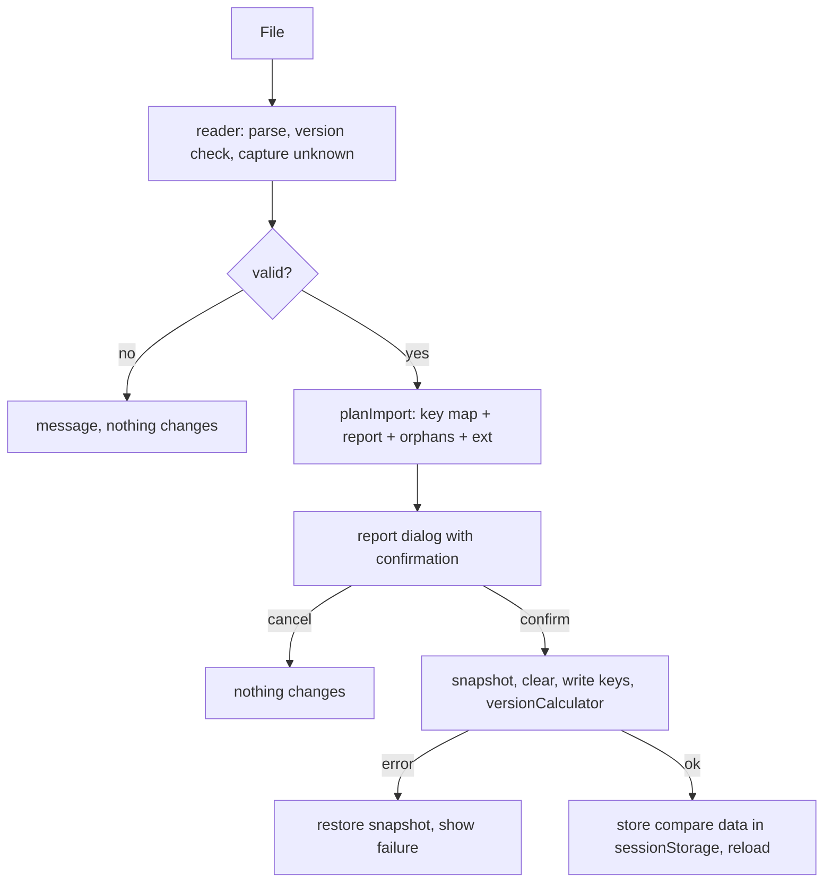

# Calculator Exchange Import and Export - Plan

## Goal Capsule

- **Objective:** The anno-117-calculator exports and imports the tool-neutral exchange format next to its existing
  config dump, keeps everything it does not understand, and applies the trade, discovery, need and material rules of
  the requirements.
- **Authority:** Nico owns this plan and the calculator. The requirements in `docs/spec/exchange-format-requirements.md`
  rank above this plan; a conflict goes back to the requirements.
- **Repos:** `anno-117-calculator` (units U1-U12) and the new specification repo `anno-117-exchange-format` (unit U0).
  File paths below are relative to the calculator repo unless marked *(spec repo)*.
- **Stop and ask when:** a dependency has to be added (U1 proposes `ajv` as a dev dependency), a stored key name
  outside the ones listed in the Planning Contract has to change, or the import cannot be made atomic (U8). Governor
  suppliers are preserved and not applied (R52), because `passiveTrade.userSetAmount` is one key shared by all
  products (`world.ts` persists every product under the same key) and cannot hold per-good rates; changing the storage
  to a per-product key would be a stored-key change and needs Nico's approval.
- **Execution profile:** `src/exchange/*` are pure functions, written test-first through the Playwright harness
  (they run in the bundle). The UI units are verified by driving the page. Build before every test run.
- **Tail:** no push, no release, no commit of `dist/calculator.bundle.js`. Existing `exportConfig` and the old import
  stay unchanged.

## Product Contract

### Summary

Add an exchange-format export and import to the calculator. The import maps a file to the calculator's storage keys,
shows a report and asks for confirmation, replaces the stored data atomically and reloads. The export reads the live
state and writes a valid file that another tool, or the calculator itself, can read back without loss.

### Requirements in scope

The full text is in the origin document. This table maps each requirement to the unit that delivers it.

| Requirement | Calculator behavior | Units |
| --- | --- | --- |
| R5, R6 | Export and import next to the old dump; the old dump is read as before, so old configs migrate through export | U8, U9, U10 |
| R7 | Stable opaque island id, assigned on first export, kept on rename, removed with the island | U2 |
| R4, R8, R9, R10, R11, R12, R18, R19, R20 | Specification, schema and fixtures in the spec repo; calculator vendors them, rejects files of a newer major version and tolerates unknown content | U0, U1, U4 |
| R13, R14, R15, R38 | Preserve every unknown field at any level, attached to its island; edits win; unknown regions, buildings, effects, products and DLCs are kept | U4, U8, U9 |
| R16 | Core inputs arrive exactly | U5, U6, U7 |
| R17 | Export `computed`; compare after import | U11 |
| R21, R22 | Game island reference as match key; `source` and generator block on export | U2, U9 |
| R23 | Fertilities present or missing; absent is unknown | U5 |
| R24 | Per-building counts are the calculator's view; a per-level count maps to the level's residence building when the file has no per-building count; populations are preserved | U5, U9 |
| R25, R26, R28, R31, R40-R42, R55 | Not modelled: preserved verbatim and written back. Type-level item, aqueduct, module and effect choices come from `factories`; exact per-instance `moduleAttachments` are preserved and reported because the calculator has no per-instance module setting | U5, U9 |
| R27, R32-R35, R37, R49, R54 | Imports map to routes by the residual-supplier contract; `trade.routes`, `visits`, `minimumStock` are preserved; precedence of `imports`; the calculator does not derive imports from `routes` | U6 |
| R39, R44 | Discoveries read and written; specific effects; basis flag | U7 |
| R43 | Disabled needs list; every other need on, including needs of DLCs newly switched on | U5 |
| R46, R52 | Governor suppliers and harbours are preserved and written back, not applied; non-player islands degrade to passive trade; both with a report | U6 |
| R48 | Tri-state item slots and per-target effect states | U5, U9 |
| R50 | Construction-material end factories equal planner end buildings; explicit `fullyUtilize` on export | U5, U7, U9 |
| R53 | Not applicable: a rule for the config updater in the repository `anno-117-savegame-exchange-format` (`scripts/calculator_config/build_config.py`); the calculator reads `products[p].producer` as given | none |
| R51 | Local producer fully utilized, import covers the remainder | U6 |
| R5, R3 (calculator form) | Full replacement-scope confirmation and report | U10 |

Acceptance examples in scope, each cited by a unit: AE1-AE9, AE13, AE14, AE18, AE19, AE21-AE23, AE25. AE11 (history kept as is) and
AE20 (minimum stock) are covered by a preserved-as-is scenario in U12. Not applicable to the calculator (writer-side or
planner-side): AE10, AE12, AE15-AE17, AE24.

### Scope Boundaries

**Deferred for later**

- Exporting live statistics values (`live`) and recording history; the calculator keeps imported `history` as is.
- Mapping `effectCoverage` (per residence building) to the format's `residenceEffects.byResidence`; until then the
  calculator's values and the file's `residenceEffects` stay preserved verbatim.
- Showing imported history or trade routes in the interface.

**Outside this work**

- Changes to the planner or the layout tool; reading `.a8s` files; the old dump format itself.

## Planning Contract

### Key Technical Decisions

- KTD1. **Import builds a complete key map first, then writes.** The importer produces `Record<string, string>` of raw
  localStorage keys, validates every JSON string in it, then writes in one pass. It never creates live `Storage`
  objects (their debounced `save()` would overwrite imported data). This is how the old import behaves.
- KTD2. **Atomic replace with rollback.** The previous `localStorage` content is snapshotted in memory before
  `clear()`. A `QuotaExceededError` or any exception during the write restores the snapshot and reports the failure;
  `location.reload()` runs once, last. Island stores are written as compact JSON.
- KTD3. **Island id is an island-store key `exchange.islandId`.** It follows the `gameConnector.*` getter/setter pattern
  on `Island`, survives rename (`Storage.updateKey` rewrites the same `json`) and is deleted with the island
  (`IslandManager.delete` removes the store).
- KTD4. **Preserved data lives in `exchange.ext`.** Island-level unknown fields go into the key `exchange.ext` inside
  the island store (R14). Document-level unknown fields, islands that cannot be loaded, and unknown GUID-keyed core
  entries go into a new top-level localStorage key `exchange.ext`. On export, preserved islands and GUID-keyed entries
  are restored to their original core locations; only extension data remains under `ext`. Nothing is preserved inside
  stores that the app re-serializes from its model (`tradeRoutes`, `collapsibleStates`, `statisticsCollections`).
- KTD5. **Islands with an unknown session are not written as stores.** The `Island` constructor throws for a session
  GUID it does not know and the app would not start. Such islands (a later DLC region) stay in
  `exchange.ext.orphans` with all their data and are listed in the report (R38). The exporter restores each orphan as
  an `islands[]` record with its original session GUID and data.
- KTD6. **Unique, non-reserved island names.** Imported display names that collide with another island or with a
  reserved key (`All Islands`, every top-level key, every key pattern prefix) get a numeric suffix. The original
  display name is kept in the island's `exchange.ext`.
- KTD7. **Hand-written runtime validation, full schema validation in tests.** The bundle checks required keys, types of
  known keys and the major version; the full JSON Schema runs in tests through `ajv` (dev dependency). The bundle
  carries no validator library.
- KTD8. **Needs: only disabled needs are written.** A listed need gets `<level>[<need>].checked` = "0". Every other
  key is left absent. An absent key reads as on: a need keeps its constructor default `checked = true`
  (`consumption.ts:104`) and `persistNeedChecked` restores a stored value only when the need is available
  (`world.ts:730-733`). The option `activateAllNeeds` is not persisted (`world.ts:296-302` sets it true on every load) and
  matters only for a need that becomes available during a session without a stored key (`world.ts:742-748`) and for
  newly created islands, so it needs no handling in the import. A stored "0" for a need of a DLC that is off is applied
  when the DLC is switched on (`world.ts:744-745`), which is what R43 asks for; a DLC switched on later turns the
  unlisted needs on (AE22). The exporter writes `disabledNeeds` for every island, an empty object when no need is
  off, so a reader can tell "none disabled" from "not provided"; a file island without the key is reported as not
  provided and imports with every need on.
- KTD9. **Residual supplier and local producer follow R54 and R51.** The default supplier route is the residual
  supplier of R54: the supplier flagged `default`; with no flag and at least one `share`, the largest share, ties by the
  lexically smallest island id; with neither, there is no residual supplier. More than one flagged default is reported and the
  entry is preserved, not written. Every other
  supplier is an ordinary route. A `userSetAmount` comes only from an `amount` the file carries (basis entered), on
  the default route too: the calculator supplies `max(userSetAmount, amount)` (`trade.ts`), so the value is a floor
  under that supplier's import and any surplus over demand counts as excess production. When the receiving island has a
  local producer, the producer's `<factory>.buildings.fullyUtilizeConstructed` is "1" unless the file states `fullyUtilize`
  false for it (the file's value wins, R15, R16). `<product>.defaultSupplier.*` is left alone for a trade-route default:
  the trade manager overrides it on load.
- KTD10. **Discoveries come from a table.** `params.techs` (16 entries) maps a researched discovery to its effect
  GUIDs; scale is 0/1, the repeat count for Beneath Bedrock (37870). Nile flood (155616) and the volcano effects
  (145095, 148043, 145099) are specific effects in `sessionSettings`; Vervactor's Plough (43620) and the other wonder
  effects are specific effects in `globalEffects`. The four dormant area-buff keys are never written.
- KTD11. **Types are hand-written** in `src/exchange/types.ts`; `src/types.config.ts` stays generated and untouched.
- KTD12. **A narrow test and debug entry `window.exchange`** (installed by `src/exchange/index.ts`) exposes `readExchange`,
  `uniqueName`, `planImport`, `applyImport`, `buildDocument` and `computeSummary`, like `window.exportConfig`. Tests call the
  pure functions through it. U1 creates the object; U2, U4, U7, U8, U9 and U11 add `src/exchange/index.ts` to their Files and
  register the function they deliver.
- KTD13. **The calculator reads explicit choices, not defaults.** The exporter reads `localStorage`, so it writes what the user
  set, plus the exceptions that the format names as explicit (`fullyUtilize` of construction-material end factories, R50, and
  of module buildings, whose default is also on; `disabledNeeds`
  as an object per island, KTD8). A product's `producer` is written only when the active default supplier is that
  factory (the stored `defaultSupplier.type` stays `factory` while a trade route is the effective default); a stored
  `null` default is written as `producer: none`; a passive-trade or extra-good default is kept in `ext.calculator`.
- KTD14. **Module attachments follow R55.** `moduleAttachments[]` is preserved unchanged in the island's `exchange.ext` and the
  report lists it as per-instance, not applied; the type-level state comes from `factories[f].modules`
  (`<f>.module[<m>].checked`). On export the attachments of a factory type are written back only while that type's
  `<f>.module[<m>].checked` equals the value the import wrote (`exchange.ext` keeps it); if the user changed it, that type's
  attachments are dropped and the report says so (R15, R55).
- KTD15. **Preserved document-level entries lose what names a deleted island (R14).** On export, route stations, visits, `history`
  and `live` entries and supplier references in preserved `trade.imports` that name an island id absent from `islands[]` are
  removed from the preserved copy and counted in the report.

### Assumptions

- The specification repo exists with a tagged `v1.0.0` before U1 starts; Taludas reviews it (U0 output) because the
  planner implements the same schema. The reference derivation rule of the trade fixtures (layout decision LD9) and the
  `ext.planner` rows of the planner plan (PD4) are settled before the tag, because the vendored fixtures and the schema encode
  them.
- `params.js` of the installed calculator version is the game data; GUIDs missing from it are reported and preserved.
- Existing first-run behavior (`versionCalculator` absent) is avoided by always writing `versionCalculator`.

### Open decisions

Each blocks the unit named and every unit that depends on it. `calculator-plan-decisions.md` records the reasoning and the
status of every decision. Settled and not repeated here: device preferences survive an import (R5, CP10; U8 merges the
`language` key of `calculatorSettings`, `main.ts:528-534`, and restores `darkMode.checked`, `views.ts:50`).

Settled by Nico:

- Disabled needs the calculator cannot apply (unknown GUID, needs of a DLC that is off, a level the calculator does not
  show): localStorage may hold keys that the calculator neither reads nor writes. The importer writes every listed disabled
  need as a "0" key (R43); the calculator ignores the keys it does not model, and the exporter lists every stored "0" key of the
  need-key shape, so such needs need no copy in `exchange.ext` (U5, U9).
- `settings.dlcs`: a list of DLC numbers (1 Prophecies of Ash, 2 The Hippodrome, 3 Dawn of the Delta; the calculator's `DLC.id`
  and asset GUID per number are in the catalog). The planner keeps its active DLCs in settings and the savegame holds them, so
  the layout writer derives `settings.dlcs` from the save (layout LD8). The exporter writes the numbers of the DLCs with
  `checked` on. When a file has none, the importer writes no DLC keys; `DLC.used` switches a
  DLC on at load when a dependent observable is non-zero (`util.ts:424-437`, via `lockDLCIfSet` in `factories.ts:119`), U7
  adds a runtime test that confirms it, and the report names DLCs enabled this way (U7).
- A fractional `devotion` or another non-integer value for a field the calculator loads with `persistInt` (`devotion`, `world.ts:1151`)
  is written as given and truncated at load; the report lists it as approximated, because R16 is exact only for integers (U5).

| ID | Question | Recommendation | Blocks |
| --- | --- | --- | --- |
| CD3 | Island name after a collision suffix (KTD6): which `name` does the exporter write? | The suffixed name, with the original kept in `exchange.ext` and shown in the report; round-trip tests compare after the suffix rule. | U2, U9 |
| CD4 | Strictness: which wrong-type or out-of-range values are coerced, dropped or fatal (negative or fractional counts, strings for numbers, non-unique ids)? | Coerce numeric strings with the loaders' own `parseInt`/`parseFloat`; drop a value that cannot be coerced with a report line; reject only the envelope problems of R18 and the version gate of R4. | U1, U4 |
| CD6 | In applied basis (Plan and Master view modes), does the exporter write discovery-derived scales to `effects.global`? | No: only effects the user set specifically; `research.basis: "applied"` then says the lists are settings (R44). | U7, U9 |
| CD7 | When `settings.volcano` and the volcano effects in `effects.bySession` both exist and differ, who wins? | Each reader uses the representation its model carries: the calculator the specific effects (R39), the planner its setting (P6); files written by either tool agree; a conformance fixture with a disagreement expects only a report. Recorded in `spec/conversion-rules.md`. | U7 |
| CD10 | When is a preserved governor or non-player supplier restored on export, once the user has changed the product's default supplier? | Restore it only while the product's default is still the passive-trade supplier it was degraded to and `userSetAmount` is unchanged; otherwise drop it from the export (R15) and say so in the report. | U6, U9 |

Deferred, not a decision of this plan (CD8): a per-product passive-trade key (`<product>.passiveTrade.userSetAmount`) would let
the calculator apply governor rates. Governors are preserved (R52); a later storage change needs Nico's approval and a one-time
read of the old key.

### High-Level Technical Design

Import:

Export: read live `localStorage` leniently (numbers and strings mixed), assign missing island ids, build the document
from stores, restore unknown-session islands and unknown GUID-keyed entries to their original core locations, then
append only preserved extension content from `exchange.ext`.

Key mapping (format key -> calculator storage; island scope unless marked global):

| Format | Calculator |
| --- | --- |
| `islands[].id` | island store `exchange.islandId` |
| `islands[].name` | store key and entry in `islandNames` (unique, KTD6) |
| `session`, `gameIsland` | `session`; `gameConnector.islandID`, `gameConnector.areaIndex` |
| `buildings[g]` | `<g>.buildings.constructed/planned/fullyUtilizeConstructed` |
| `disabledNeeds`, `needNotes` | `<level>[<need>].checked` = "0"; `<level>[<need>].notes` |
| `fertilities` | `island.fertility.<g>.checked` |
| `patron`, `devotion` | `selectedPatron`, `devotion` (as entered) |
| `factories[f].items` | `<f>[<item>].scaling` 1 base, 2 boosted; unlisted = off |
| `factories[f].effects` | `<f>[<effect>].scaling` 1 |
| `factories[f].aqueduct`, `.modules` | `<f>.aqueductBuff.checked`; `<f>.module[<m>].checked` |
| `effects` | `island.effect.<g>.scaling` |
| `products[p].notes` | `
.notes` |
| `products[p].producer` | `
.defaultSupplier.type` "factory" and `.id`; `none` writes the string "null" for both keys (restore needs both truthy, `world.ts:1081-1083`); absent writes nothing (KTD13) |
| `buildings[g].planned` | `<g>.buildings.planned`, one to one: the field is persisted and summed in `aggregate.ts:131` and drives no result, so it is carried and not interpreted |
| `residencesByLevel` | `<residence building>.buildings.constructed` of the level's residence building, only when `buildings` has no count for it (R24) |
| `materials` | `constructed` and `fullyUtilize` of the region's end factory (R50) |
| `trade.imports` | `tradeRoutes` entries (`isDefaultSupplier`, `userSetAmount` from the supplier `amount`) and the R51 flags |
| `settings.dlcs` (numbers 1, 2, 3) | `calculatorSettings` keys `DLC01_Prophecies_of_Ash`, `DLC02_The_Hippodrome`, `DLC03_Dawn_of_Delta`, written `"1"` for a listed number and `"0"` for an unlisted one; a number outside 1-3 is preserved in `exchange.ext` (R19, R38) |
| `settings.difficulty` need consumption | `calculatorSettings["settings.needConsumption"]` |
| `effects.global` / `effects.bySession` | `globalEffects` / `sessionSettings` |
| `research` | derived effect scales (KTD10) |

Everything else (planner fields, itemHolders, moduleAttachments, appliedEffects, harbour, position, fleet, routes, visits, history,
minimumStock, unknown fields) goes to `exchange.ext`. Calculator-only state (`collapsibleStates`, `darkMode.checked`,
`statisticsCollections`, the "All Islands" store, shared `passiveTrade.userSetAmount`, `effectCoverage`) is written to
`ext.calculator` on export and restored from it on import.

### Sequencing

U0 -> U1 -> {U2, U3, U4} -> U5 -> U6 -> U7 -> U8 -> U9 -> U10 -> U11 -> U12. Unit tests of U5, U6, U7 and U8 assert on the key
map, the plan object and the report; every scenario that needs a reload, an export or a round trip is in U9, U12 or U10, so no
unit waits for a later one. U9 may be drafted after U5 with the mapping read in reverse but lands behind U8.

## Implementation Units

| U-ID | Title | Key files | Depends on |
| --- | --- | --- | --- |
| U0 | Specification repo: schema, text, fixtures | *(spec repo)* `schema/`, `spec/`, `fixtures/` | none |
| U1 | Vendor spec, types, entry point | `vendor/anno117-exchange/`, `src/exchange/types.ts`, `src/exchange/index.ts` | U0 |
| U2 | Island ids, unique names, reserved keys | `src/world.ts`, `src/exchange/names.ts` | U1 |
| U3 | Mapping tables | `src/exchange/keys.ts`, `src/exchange/discoveries.ts`, `src/exchange/materials.ts` | U1 |
| U4 | Reader with unknown-field capture | `src/exchange/reader.ts` | U1 |
| U5 | Import plan: islands, buildings, needs, fertility, items | `src/exchange/import-islands.ts` | U2, U3, U4 |
| U6 | Import plan: trade and suppliers | `src/exchange/import-trade.ts` | U5 |
| U7 | Import plan: discoveries, effects, settings, materials; `planImport` | `src/exchange/import-effects.ts`, `src/exchange/plan.ts` | U3, U5, U6 |
| U8 | Atomic writer and preserved data | `src/exchange/writer.ts` | U5, U6, U7 |
| U9 | Exporter | `src/exchange/exporter.ts` | U2, U3, U8 |
| U10 | Interface: buttons, report dialog, texts, wiring | `templates/download-dialog.html`, `templates/exchange-report-dialog.html`, `src/i18n.ts`, `src/main.ts`, `src/components.ts` | U8, U9 |
| U11 | Computed block and post-import comparison | `src/exchange/computed.ts`, `src/exchange/exporter.ts`, `templates/exchange-report-dialog.html`, `src/main.ts` | U9, U10 |
| U12 | Integration suite and documentation | `tests/exchange/`, `tests/fixtures/exchange/`, `docs/exchange-format.md` | U11 |

### U0. Specification repo: schema, text, fixtures

**Goal:** Create `anno-117-exchange-format` with the contract all three tools vendor.
**Requirements:** R8-R12, R18-R20, R35.
**Dependencies:** none. Owner: Nico; Taludas reviews before the `v1.0.0` tag.
**Files (spec repo):** `schema/anno117-exchange.schema.json`, `spec/format.md`, `spec/conversion-rules.md`,
`fixtures/valid/*.json`, `fixtures/invalid/*.json`, `fixtures/MANIFEST.json`, `tests/validate-fixtures.*`,
`scripts/vendor.py` (the single vendoring script of the three consumers: `python scripts/vendor.py --dest <path> [--check]`
copies schema and fixtures at the checked-out tag, writes `VERSION`, and with `--check` fails on a differing copy), `README.md`,
`LICENSE` (MIT).
**Approach:** JSON Schema draft 2020-12 for the envelope and every catalog key of the origin document. Required keys
are `format`, `formatVersion`, `generator.name`, `islands[].id`. No closed lists for regions, building kinds, effect
kinds, source kinds or DLC names; `additionalProperties` stays open everywhere. `spec/format.md` holds the catalog,
the area key layout, the coordinate system and the reference trade derivation (R37, R51); `spec/conversion-rules.md`
holds the conversion table. Fixtures: minimal third-party file, unknown generator, newer minor, newer major (invalid),
unknown fields at every level, unknown region/building/effect/product/discovery GUIDs, island deletion and rename
pairs, the Cinis sawmill island (4 sawmills, 8 t/min Wood), disabled needs with a newly switched-on DLC, the trade
constellations of R35 (point to point, distribution circuit with relays, relay net zero, manual one-slot route,
distribution across sessions, multi-source collection, non-player station, same sink twice, loaded never unloaded,
bidirectional circuit, shared supply, no ships), history and live blocks. `MANIFEST.json` lists, per fixture, whether
it is valid and the expected reason when it is not.
**Test scenarios:**
- Every valid fixture validates against the schema; every invalid fixture fails with the reason named in the manifest.
- The schema itself validates against the draft 2020-12 meta-schema.
- A file with only `format`, `formatVersion`, `generator.name` and one island with an id validates (AE6).
- A value outside any listed region name validates (open lists).
**Verification:** the fixture test passes in the spec repo; Taludas confirms the catalog before the tag.

### U1. Vendor spec, types, entry point

**Goal:** The calculator carries a pinned copy of schema and fixtures, hand-written types and the `window.exchange` entry point.
**Requirements:** R8, R9, R19, R20; KTD4, KTD7, KTD11, KTD12.
**Dependencies:** U0.
**Files:** `vendor/anno117-exchange/schema.json`, `vendor/anno117-exchange/fixtures/**`,
`vendor/anno117-exchange/VERSION`, `src/exchange/types.ts`, `src/exchange/index.ts` (installs `window.exchange`, KTD12),
`package.json` (dev dependency `ajv` after approval).
**Approach:** The vendored folder is written and checked by the single vendoring script of the specification repo
(`python <spec checkout>/scripts/vendor.py --dest vendor/anno117-exchange [--check]`, U0), so the calculator carries no sync script.
The runtime validation (required keys, types of known keys, `formatVersion`, duplicate island ids) is part of the reader of U4,
which makes one pass over the document. Types mirror the catalog; unknown content is `Record<string, unknown>`. `ajv` stays
for the one check that the exporter's output validates (U9); if Nico does not approve the dependency, U9 and the Definition of
Done fall back to the runtime reader and the conformance manifest alone, and the plan says so in the report of U12.
**Patterns to follow:** `types.ts` interface style; `window.exportConfig` for the entry point.
**Test scenarios:**
- `window.exchange` exists as an object after the bundle loads; each later unit registers its own function in `src/exchange/index.ts` and asserts that it is exposed.
- The vendored schema loads in `ajv` (used by U9 and U12).
**Verification:** `npm run type-check`; the vendoring check prints no diff.

### U2. Island ids, unique names, reserved keys

**Goal:** Stable island ids and collision-free imported names.
**Requirements:** R7, R21; KTD3, KTD6.
**Dependencies:** U1.
**Files:** `src/world.ts` (`Island`: id getter/setter next to `setGameConnectorIdentity`), `src/exchange/names.ts`,
`tests/exchange/island-id.spec.ts`.
**Approach:** `exchange.islandId` is read through `Storage.getItem`, assigned lazily on first read as a random opaque
string (16 hex), and written with `setItem`. `names.ts` exports `reservedKeys()` (all top-level keys and the key
prefixes the app uses) and `uniqueName(wanted, taken)`.
**Test scenarios:**
- A fresh island gets an id on first export call; the id is identical after reload.
- Renaming an island keeps the id (storage key changes, `exchange.islandId` unchanged).
- Deleting an island removes the store and its id (R14).
- Two imported islands both named "Latium 5" get "Latium 5" and "Latium 5 (2)"; the file's display names stay in `exchange.ext` (AE7 shape).
- Names `tradeRoutes`, `devotion`, `language`, `All Islands`, `islandNames` get a suffix.
**Verification:** Playwright `tests/exchange/island-id.spec.ts`.

### U3. Mapping tables

**Goal:** One place for every static mapping the importer and exporter use.
**Requirements:** R39, R50; KTD10.
**Dependencies:** U1.
**Files:** `src/exchange/keys.ts` (storage key patterns and builders), `src/exchange/discoveries.ts`
(tech GUID -> effect GUIDs, repeat flag, specific effects), `src/exchange/materials.ts` (material product -> end
factory per region), `tests/exchange/tables.spec.ts`.
**Approach:** Build `discoveries` from `window.view.params.techs` at runtime, plus the specific-effect lists as
constants with comments naming the source. `materials` is derived from products with `isConstructionMaterial`, the
factory that outputs it and `associatedRegions` (13 materials; Sawmill 3089 Latium, 5945 Albion, 152803 Aegyptus).
**Test scenarios:**
- All 16 techs resolve to existing effects; only 37870 is repeatable.
- Each of the 13 materials has an end factory in each region where it is available; the Timber/Sawmill pair matches the three GUIDs.
- Specific-effect lists contain 155616, 145095, 148043, 145099 (session) and 43620 (global); none of the four area-buff GUIDs (51796, 30467, 38412, 38411) appears anywhere in the writable set.
**Verification:** table spec passes.

### U4. Reader with unknown-field capture

**Goal:** Turn a file into a typed document and capture everything unknown with its location.
**Requirements:** R4, R13, R14, R18, R19, R38.
**Dependencies:** U1.
**Files:** `src/exchange/reader.ts`, `tests/exchange/reader.spec.ts`.
**Approach:** `readExchange(text)` makes one pass and returns `{doc, unknown, problems}` or an envelope error. Envelope errors
(not JSON, wrong or missing `format`, `formatVersion` major above the supported one with both versions named, missing
`generator.name`, missing or duplicate island ids) reject the file (R4, R18); a newer minor passes. `unknown` is a list of
`{pointer, value, scope}` for fields not in the catalog, grouped by island id or document. Catalog keys the calculator does
not model (`itemHolders`, `moduleAttachments`, `appliedEffects`, `rangeBuffs`, `harbour`, `position`, `islandFile`,
`islandSize`, `publicCoverages`, `villaCoverage`, `residenceItems`, `residenceEffects`, `islandItems`, `romanization`, `wonders`, `extraDemand`, `population`, `layout`, `dominantPatron`,
`fleet`, `settings.map`, `name`, `history`, `live`) are captured the same way with their original core location, so they are
written back (R13). `computed` is kept only for the comparison of U11 and is never exported from the file's copy. Known-key values of an unexpected type are `problems` (CD4: coerced when
numeric strings, otherwise dropped with a report line). Unknown keys inside known maps keyed by GUID (building, effect,
product, discovery GUIDs) are data for the importer, which reports GUIDs absent from `params`.
**Test scenarios:**
- A file with a newer major version fails with a message naming both versions (AE4 form); a newer minor passes.
- Duplicate island ids fail; unknown keys at every level pass.
- The manifest marks each invalid fixture as `envelope` (the reader rejects it, with the manifest reason) or `schema` (the reader returns a document with `problems`, CD4; only the schema check of the conformance test rejects it); each valid fixture reads without envelope error.
- Unknown field at document level, at island level and inside `ext.<other>` is captured with the right pointer and scope (AE1).
- A file from an unknown generator with only islands and building counts reads without problems (AE6).
- An unknown region GUID in `session` is kept as data, not rejected (AE18).
- A fixture with a wrong-typed known key returns a document and a `problems` entry; a fixture with an envelope error returns no document.
**Verification:** reader spec passes.

### U5. Import plan: islands, buildings, needs, fertility, items

**Goal:** Map island-scope data to island stores.
**Requirements:** R16, R23, R24, R25, R26, R43, R48, R50, R55; KTD5, KTD8, KTD14.
**Dependencies:** U2, U3, U4.
**Files:** `src/exchange/import-islands.ts`, `tests/exchange/import-islands.spec.ts`.
**Approach:** For each island: skip and orphan it when `session` is not in `window.view.sessions` (KTD5). Otherwise the island's
name is `name`, else `gameIsland.name`, else its id, passed through `uniqueName` (KTD6); the result is the store key and the
name U6 uses for `from` and `to`. Build the store as a plain object: `session`, `exchange.islandId`, `gameConnector.*` from `gameIsland`, buildings
(`constructed` from `built`, `planned`, `fullyUtilizeConstructed` as "1"/"0" only when the file states it; an absent flag
on a construction-material end factory means on, which is the calculator's default and needs no key, R50),
`disabledNeeds` -> `checked` "0" (KTD8), `needNotes`, `fertilities` (true/false -> checked; with `fertilitiesComplete`
true an absent GUID is unchecked; otherwise an absent GUID gets no key and the calculator applies its own default, with a
report line "not provided"), `patron` and `devotion` without rounding, and `factories`: a factory entry in the file is
authoritative for that factory's items (listed 1 or 2, unlisted no key), effects, aqueduct and modules; a factory without an
entry gets no keys. Residences: the per-building count wins; for a level with no per-building count, the level count of
`residencesByLevel` becomes `constructed` of that level's residence building (one building per level in `params`), and the
importer reports a difference when both exist and disagree (R24). Island `effects` are written as given. GUIDs absent from
`params` are kept in the island's `exchange.ext` with their original core location recorded, restored to that location by the
exporter, and listed in the report. `notes` (per residence building) become `<residence building>.notes` and `needNotes` become
`<level>[<need>].notes`. `population`, `moduleAttachments` and every other captured catalog key the calculator does not model go to
`exchange.ext` (U4); the report lists `moduleAttachments` as per-instance and not applied, and the import writes the type-level
`<f>.module[<m>].checked` from `factories[f].modules` only (KTD14), recording the written value in `exchange.ext`.
**Execution note:** Test-first; each mapping row of the Planning Contract table gets its own scenario.
**Test scenarios:**
- Disabled needs `[a]` for Cinis writes `checked` "0" for `a` only and no key for any other need, including the DLC 3 needs (AE22; the runtime toggle is checked in U12).
- 94 Wader residences by building and 129 by level: 94 is applied, the report names the difference (AE9).
- Item listed as boosted -> `scaling` 2; listed unboosted -> 1; unlisted -> no key (R48).
- A fertility list absent -> no `island.fertility` keys, the report lists them as not provided (AE8); `fertilitiesComplete: false` with `GUID: false` unchecks only that fertility; `fertilitiesComplete: true` unchecks every absent one.
- A file with only `residencesByLevel` for Waders (129) writes `constructed` 129 on the Wader residence building; with a per-building count of 94 as well, 94 is written and the difference is reported (F1, AE9).
- A factory entry that lists one item writes that item's `scaling` and no key for the other items; a factory without an entry gets no keys (R48).
- A need of a DLC that is off: with no key in the key map it is on after the DLC toggle; with the "0" the file's `disabledNeeds` produced it is off (KTD8; the toggle itself is checked in U12).
- `notes` on a residence building and `needNotes` land in the key map under their storage keys.
- Three farms with a silo attachment on one: the key map has `<f>.module[<m>].checked` from `factories[f].modules` and the attachment sits unchanged in `exchange.ext`; the plan's report lists it as per-instance and not applied (KTD14, AE25).
- Value types: boolean keys are written as the strings "1" and "0", counts as numbers, `gameConnector.*` as real numbers (`getGameConnectorIdentity` returns null for anything else, `world.ts:1344`); a `devotion` with a fraction is written as given and reported as truncated at load.
- An absent `fullyUtilize` on a construction-material end factory and on a module building means on (calculator default, `factories.ts:610-611`, `factories.ts:427`) and gets no key.
- An unknown building GUID count and an unknown effect scale are retained in the island's `exchange.ext` with their original core location recorded (AE18; the restore on export is tested in U9).
- An island with session 99999 becomes an orphan, no store is created.
- Devotion 64980 stays 64980.
**Verification:** spec passes.

### U6. Import plan: trade and suppliers

**Goal:** Map `trade.imports` to `tradeRoutes` and supplier flags with the R37, R46, R51, R52 rules.
**Requirements:** R27, R32-R35, R37, R46, R49, R51, R52, R54; CD10.
**Dependencies:** U5; the trade fixtures of U0, whose rule is settled before the tag (LD9).
**Files:** `src/exchange/import-trade.ts`, `tests/exchange/import-trade.spec.ts`.
**Approach:** For each import entry (receiving island, product, suppliers), in file order: suppliers that are islands of the
file become `tradeRoutes` entries (`from`/`to` written as the final unique island names, so this runs after names are
fixed; entry order stable). The residual supplier of KTD9 is the default route (`isDefaultSupplier` true); an entry whose
suppliers carry no `default` flag and no `share` has no residual supplier: all its routes are ordinary and the product's default
supplier is left as it is (R54). Every other
supplier is an ordinary route. `userSetAmount` is the supplier's `amount` when the file carries one (basis entered),
otherwise 0, on the default route as well (KTD9). A zero-minimum ordinary route is written: it is an alternative supplier
and the exporter writes it back (U9). When the receiving island has a local producer for the product in the file's
`buildings`, that factory is set fully utilized unless the file states otherwise (KTD9). Non-player islands and islands
that are not in the file (including orphans) become the `passive_trade` default of that product (`.type`/`.id` written)
when no island supplier remains, otherwise they are kept in `exchange.ext`; either way the original supplier stays in
`exchange.ext` with a report line (R52). `{governor}` suppliers and `trade.governorHarbours` are preserved at their file
location, not applied, and restored on export; the shared `passiveTrade.userSetAmount` is not written for them. Routes
that name the "All Islands" aggregate or an orphan island cannot be expressed as file suppliers and are exported
from and restored through `ext.calculator`. Cycles are checked over the default routes of the whole final route set in file
order (as `Product.isSuppliedFrom`, which `setAsDefaultSupplier` applies silently at load); an offending default loses
its default flag, stays as an ordinary route with its amount, and the report names it; the original import entry (for a cycle and for an ambiguous default alike) is also kept in `exchange.ext` and restored by U9 while the product's routes are unchanged, as in CD10, and dropped with a report line otherwise (R54). `trade.routes`, `visits`,
`governorHarbours` and `minimumStock` go to `exchange.ext` unchanged; the calculator does not derive imports from
`trade.routes` and reports the routes as preserved (R49).
**Execution note:** Test-first with the R35 fixture set.
**Test scenarios:**
- Dates distribution (source + 3 relay stops + sink, 4 receivers): four default routes from the source island, `userSetAmount` 0 (AE13).
- Two suppliers with shares 2:1: the larger is default, the smaller an ordinary route at 0 (AE14); with supplier `amount` values both keep their amounts as `userSetAmount`, the default among them still the larger.
- An explicit `default` flag on the smaller supplier makes it the default route; two flags are reported and the entry is not written (R54).
- A default route with `amount` 10 and demand 4: `userSetAmount` 10, import 10, surplus 6 counts as excess production (R54 floor).
- Listening Weasel Nome Gold: local producer 152358 gets `fullyUtilizeConstructed` "1", Cinis route is default at 0, no minimum (R51); with `fullyUtilize: false` in the file the flag stays "0".
- Two governor goods with different rates: the suppliers and `trade.governorHarbours` sit unchanged in `exchange.ext` and the key map has no route for them (R52, R46); the reload and export half is tested in U9.
- A non-player supplier alone becomes the passive-trade default in the key map and the original supplier is kept in `exchange.ext` (the restore on export is tested in U9, CD10).
- A two-island cycle for one product keeps the second route as an ordinary route with its amount and reports it.
- Exactly one default route is written per receiving island and product: `updateDefaultSupplier` calls `prev.unsetAsDefaultSupplier()` (`production.ts:338`), which for a route with `userSetAmount` 0 calls `delete()` and dereferences `window.view.tradeManager`, still null while the `TradeManager` constructor restores routes (`trade.ts:125-131`, `main.ts:92`); two stored defaults for one product would throw at load. A test imports a file with two flagged defaults and expects no write and a report line.
- Route fixture without ships and with only non-player stations produce no entries and a report line.
- `imports` and `routes` disagree: `imports` wins (R49).
**Verification:** spec passes.

### U7. Import plan: discoveries, effects, settings, materials

**Goal:** Map document-scope data and construction materials.
**Requirements:** R39, R44, R50; KTD10.
**Dependencies:** U3, U5, U6.
**Files:** `src/exchange/import-effects.ts`, `src/exchange/plan.ts` (`planImport`: assembles the island, trade and effects
parts into one key map plus the report model of carried-through, not-mapped, approximated and not-provided entries),
`tests/exchange/import-effects.spec.ts`.
**Approach:** `research.researched` and `counts` -> `globalEffects` scales (0/1, count for 37870) via the discoveries
table; `effects.global` and `effects.bySession` -> `globalEffects` / `sessionSettings` entries as given (specific
effects win over `research`); volcano level and effects from `settings.volcano` -> the three session effects (level
to each unlocked effect, 0 to the others, sessions 3245 and 37135); `settings.seasons.enabled` in average mode -> 155616
in session 149679; `settings.dlcs` -> `calculatorSettings` keys; need consumption option id. A file with
`research.basis: "applied"` is treated as settings, not researched state (R44); an absent basis means researched. Materials:
the `buildings` entry of the end factory wins over `materials` for `constructed` and `fullyUtilizeConstructed`; a `materials` count
writes only the keys the file's `buildings` does not state (`constructed`, and "1" for `fullyUtilizeConstructed` unless a state is
given), and a difference between the two is reported (R50). `settings.volcano` and the volcano effects in `effects.bySession`:
the specific effects win and a difference is reported (CD7); `settings.seasons` against effect 155616 follows the same rule.
Planner-only settings go to `exchange.ext`. Area-buff GUIDs are never written.
**Test scenarios:**
- Researched 37870 with count 5 writes `82017.scaling` 5; researched with no count writes 1 (AE19).
- A file with obsidian gathering as a specific effect keeps that effect and the soil level as stated (AE19).
- `settings.volcano.level` 5 with two unlocked effects writes 5 and 5, and 0 for Fertile Soil if not unlocked, in sessions 3245 and 37135.
- Seasons in phase mode (not average) writes nothing for 155616 and reports it.
- `materials` Timber 4 on a Latium island writes `3089.buildings.constructed` 4 and `3089.buildings.fullyUtilizeConstructed` "1" (AE21).
- No area-buff key is written for any input.
- `buildings[3089].fullyUtilize: false` with `materials` Timber 4: `fullyUtilizeConstructed` "0", `constructed` from `buildings`, and the difference is reported; with no `buildings` entry for the sawmill, `materials` writes `constructed` 4 and "1".
- A file with `research.basis` absent and `research.researched` lists the discoveries as researched; with basis "applied" the lists are settings (R44).
- `planImport` returns one key map and a report with the four lists for a fixture with islands, trade and effects.
**Verification:** spec passes.

### U8. Atomic writer and preserved data

**Goal:** Replace the stored data safely and keep everything unmapped.
**Requirements:** R5 (replace after full-scope confirmation; device preferences kept), R13, R14, R38; KTD1, KTD2, KTD4.
**Dependencies:** U5, U6, U7.
**Files:** `src/exchange/writer.ts`, `tests/exchange/writer.spec.ts`.
**Approach:** `applyImport(plan)`: snapshot all `localStorage` entries; validate every JSON string (island stores,
`tradeRoutes`, `sessionSettings`, `globalEffects`, `calculatorSettings`); `clear()`; write keys; always write
`versionCalculator`, `islandNames` (order: as `sortIslands` would sort, but the stored array is rewritten by the app on
load), `islandName` (first island); after `clear()` restore the device preferences: `darkMode.checked` and the `language` key
merged into the written `calculatorSettings` (R5, CP10); write `exchange.ext` top-level and per-island `exchange.ext`; on any
exception restore the snapshot; `location.reload()` last. U11 adds the hand-off of the file's `computed` block to `sessionStorage`
before the reload.
**Test scenarios:**
- A plan with an invalid JSON string aborts before `clear()`; storage unchanged.
- A simulated `QuotaExceededError` on the 20th write restores the snapshot byte for byte and reports the failure.
- After import and reload: no first-run dialog, islands listed, no Knockout binding error.
- Unknown document-level fields and an island's unknown field are written to the top-level and the per-island `exchange.ext` (the import -> export -> import half, AE1, is tested in U9).
- Deleting an imported island in the app removes its store and with it the preserved island data; renaming keeps it (AE2, island scope; the document-level part is tested in U9).
- An orphan island (unknown session) is absent from `islandNames` and present in `exchange.ext` (written back on export, tested in U9).
- `language` in `calculatorSettings` and `darkMode.checked` survive an import of a file that carries neither (R5).
**Verification:** spec passes.

### U9. Exporter

**Goal:** Write a valid exchange file from the live state.
**Requirements:** R6, R7, R13, R14, R15, R16, R21, R22, R23, R43, R44, R48, R50, R51, R55; KTD13, KTD14, KTD15; CD10.
**Dependencies:** U2, U3, U8.
**Files:** `src/exchange/exporter.ts`, `tests/exchange/exporter.spec.ts`.
**Approach:** `buildDocument()` reads `localStorage` with the same lenient parsing as the app loaders
(`parseInt`/`parseFloat`, mixed types). Generator `{name: "anno117-calculator", version: versionCalculator}`; `source {kind:
"tool"}` (no save time); island ids via U2; `gameIsland` from `gameConnector.*`; `buildings`, `disabledNeeds` (keys with "0"), `needNotes`,
`fertilities` (stored values; defaults not invented), `factories`, `effects`, `products` (notes; `producer` per KTD13),
`trade.imports` from `tradeRoutes`: every route of a receiving island and product is a supplier, the default route carries
`default: true`, a route with `userSetAmount` > 0 carries `amount` with basis `entered` (on the default route too), and a
zero-minimum ordinary route is written as a supplier without `amount`, so the alternative supplier survives a round trip;
`research` (basis "applied") and `settings` from the effect stores, `ext.calculator` (collapsibleStates, darkMode,
statisticsCollections, All Islands store, routes that name the aggregate, shared `passiveTrade.userSetAmount`,
`effectCoverage`, UI settings), then the preserved `exchange.ext` content: orphans and unknown GUID entries return to their
original core locations; the original import entry of a cycle or an ambiguous default returns while the product's routes are
unchanged (U6, CD10 rule); `moduleAttachments` per KTD14; preserved document-level entries are pruned per KTD15; a preserved
governor or non-player supplier returns per CD10; a preserved `fullyUtilize`, `planned` or other sibling field inside a
`buildings` entry stays unless the calculator's own value for it exists. `disabledNeeds` is written for every island as
an object per level (KTD8). The "All Islands" aggregate is never exported as an island. Export writes only keys the user set,
with these exceptions: construction-material end factories and module buildings always carry an explicit `fullyUtilize` (R50 and KTD13), and
`disabledNeeds` is always present. The exporter writes no export timestamp, so round-trip equality is equality of the
parsed documents, with `generator.version`, `source` and `computed` excluded (island and array order as one exporter writes
them; numbers compared as numbers, not as the stored strings).
**Test scenarios:**
- Round trip: load a fixture config, export, import the file into an empty page, export again; the two parsed documents are equal except `generator.version`, `source` and `computed`; island names are compared after the suffix rule of KTD6 (decision CD3).
- Unknown document-level fields and an island's unknown field survive import -> export -> import; a note on a need and a collapsed-panel state survive too (AE1).
- Deleting an imported island leaves no data for it in the export, including stations, visits and supplier references that named it; renaming keeps its preserved data (AE2, R14, KTD15).
- A file island in an unknown region, an unknown building count and an unknown effect scale come back under `islands[]`, `buildings` and `effects` at their original places (AE18).
- Two governor goods with different rates and a non-player supplier survive import, reload and export unchanged; after the user changes the default supplier of the non-player product to a factory, the preserved non-player supplier is dropped from the export and the report says so (R52, CD10).
- Module attachments: exported unchanged while `<f>.module[<m>].checked` is as imported; after the user toggles it, the type's attachments are dropped (KTD14, AE25).
- `notes` on a residence building survive the round trip (F1).
- A default route with `userSetAmount` 10, a zero-minimum alternative route and a local producer survive export, import and export unchanged (R54, KTD9).
- An island without any disabled need exports `disabledNeeds` as an empty object.
- The original sample (Cinis with 4 sawmills and no `fullyUtilize` key) exports `built` 4 and `fullyUtilize` true (R50).
- An edited supplier (Bread from Roma changed to Tiberia) exports Tiberia, not the stale preserved copy (AE3).
- Missing island ids are assigned and stay stable across two exports.
- A config with an island named like a reserved key exports with a valid file.
- The exported file validates against the full schema (ajv) and the runtime validator.
**Verification:** spec passes.

### U10. Interface: buttons, report dialog, texts, wiring

**Goal:** Expose export and import with a confirmation and a report.
**Requirements:** R3 (calculator form), R5.
**Dependencies:** U8, U9.
**Files:** `templates/download-dialog.html` (new row after `downloadConfig`: export and import buttons with
`fa-download`/`fa-upload` and titles), `templates/exchange-report-dialog.html` (modal, pattern
`templates/island-rename-dialog.html`), `index.html` (`
`),
`src/i18n.ts` (keys `downloadExchange`, `exchangeReportTitle`, `exchangeReplaceWarning`, `exchangeConfirm`,
`exchangeCarried`, `exchangeNotMapped`, `exchangeApproximated`, `exchangeFailed`, `exchangeInvalid`, each in all 12
languages), `src/main.ts` (`exportExchange`, `installImportExchangeListener` for `#exchange-selector`, mirroring
`installImportConfigListener`; a notification via `$.notify` after export, and the same report dialog in read-only form (no
Confirm button) when the export report is not empty, because dropped attachments, pruned entries and dropped suppliers are
reported at export, R3), `src/components.ts` only if a component is needed, `tests/exchange/ui.spec.ts`.
**Approach:** The import listener reads the file, runs `readExchange` and `planImport`; invalid files show the message
and change nothing. Otherwise the dialog names the full calculator state being replaced (island stores, calculator
settings, trade data, and preserved exchange data, with the exception that language and dark mode are kept), then lists
carried-through, not-mapped, approximated and not-provided entries (AE6, AE8), then Cancel and Confirm. Confirm calls `applyImport`. The old buttons and `exportConfig` stay.
**Test scenarios:**
- Import of an invalid fixture shows the message; storage unchanged.
- Import of a valid fixture shows the report dialog naming the full replacement scope, island count and carried-through list; Cancel leaves storage unchanged; Confirm replaces and reloads (AE23).
- Export downloads a file that validates; the filename is `Anno117CalculatorExchange.json`; an export that drops a module attachment opens the read-only report naming it.
- No binding errors on the new template; all new i18n keys exist for 12 languages (`npm run check-translations` clean).
**Verification:** Playwright `tests/exchange/ui.spec.ts` with `setInputFiles`; `npm run check-translations`.

### U11. Computed block and post-import comparison

**Goal:** Export `computed` and report differences after an import.
**Requirements:** R17.
**Dependencies:** U9, U10.
**Files:** `src/exchange/computed.ts`, `src/exchange/exporter.ts` (`buildDocument` calls `computeSummary`), `src/exchange/writer.ts`
(the `sessionStorage` hand-off), `src/exchange/index.ts`,
`templates/exchange-report-dialog.html` and `src/main.ts` (the comparison lines after reload), `tests/exchange/computed.spec.ts`.
**Approach:** `computeSummary()` reads per island the residents per population level, the required buildings per factory
type (unrounded) and the import per good in t/min from the island's computed observables. On import, the file's
`computed` is saved to `sessionStorage`; after reload and the first stable recompute the page compares with a tolerance
of 1 % or 0.1 units and shows the differences in the report dialog.
**Test scenarios:**
- Export of a fixture island contains residents per level, buildings required and imports.
- Import of a file whose `computed` residents differ by 5 % lists the island and the values after reload and does not block (AE5).
- Differences below tolerance produce no entry.
**Verification:** spec passes.

### U12. Integration suite and documentation

**Goal:** Prove the whole flow with the shared fixtures and document the feature.
**Requirements:** R20 and all acceptance examples listed above.
**Dependencies:** U11.
**Files:** `tests/exchange/conformance.spec.ts`, `tests/exchange/roundtrip.spec.ts`, `tests/fixtures/exchange/` (copies of
fixtures that need calculator-specific setup, e.g. the Cinis sawmill config), `tests/helpers/exchange.ts`,
`docs/exchange-format.md`, `tests/AGENTS.md` (exchange section), `README.md` (one paragraph).
**Approach:** `conformance.spec.ts` iterates the vendored manifest: valid fixtures import without error; invalid fixtures
are rejected with the manifest reason. `tests/helpers/exchange.ts` seeds `versionCalculator` and an empty
`islandNames` once per page (guarded, so a reload keeps the imported state; `ConfigLoader.loadConfigObject` re-seeds
on every navigation and cannot be used for reload flows) and drives `#exchange-selector`.
**Test scenarios:**
- All vendored fixtures: valid import succeeds, invalid rejected.
- Sample game: import a file derived from `Marcia 69` (22 islands, 371 trade entries) loads without binding errors and the Listening Weasel Nome Gold pair shows import 0 and local output 4.8 t/min (R51).
- Cinis sawmills: 4 sawmills require 8 t/min Wood in the calculator (AE21).
- Old dump import still works unchanged (regression).
- Round trip of the old sample dump through export and import changes no computed value.
- History and `minimumStock` of a fixture survive import and export unchanged (AE11, AE20, preserved as is).
- A DLC switched on after import turns the unlisted needs of that DLC on and keeps a listed need off (AE22, `world.ts:742-748`); a file without `settings.dlcs` whose island has a count for a DLC 3 building enables the DLC at load (runtime check of `DLC.used`) and the report names it.
- Oracle for the Marcia 69 scenarios: `Marcia 69 updated.json` with `scripts/calculator_config/cmp_runtime.py` and `run_calc.js` of the repository `anno-117-savegame-exchange-format`, which already load configs into the calculator and compare computed values.
**Verification:** full Verification Contract.

## Verification Contract

Run from the calculator repo root, one Playwright invocation at a time, build before every run.

| Gate | Command |
| --- | --- |
| Types | `npm run type-check` |
| Build | `npm run build` |
| Exchange tests | `npx playwright test tests/exchange --reporter=list` (port 8085 from `playwright.config.ts`) |
| Existing suite | `npx playwright test tests/computed tests/binding tests/e2e --reporter=list` once at the end |
| Translations | `npm run check-translations` |
| Vendored spec | `python <spec checkout>/scripts/vendor.py --dest vendor/anno117-exchange --check` |

## Definition of Done

- All units' test scenarios pass; the existing suite shows no new failures.
- `exportConfig` and the old import behave as before.
- A file written by the calculator validates against the vendored schema; a minimal third-party file imports.
- Unknown data survives import -> export -> import at document and island scope; deleting an island deletes its data.
- A forced write failure leaves the previous data intact.
- Language and dark mode survive an import (R5).
- If `ajv` is not approved, the exporter's output is validated by the runtime reader and the conformance manifest, and the report of U12 says so.
- `npm run check-translations` is clean; new keys exist for 12 languages.
- Abandoned experiments and debug code are removed; `dist/calculator.bundle.js` is not committed.
- `docs/exchange-format.md` and the `tests/AGENTS.md` section describe the feature, the preserved-data keys and the test setup.

## Risks and Dependencies

- **Spec first.** U0 blocks everything; Taludas must agree on the catalog, otherwise both tools implement different
  schemas. Mitigation: review gate before the tag.
- **Dev dependency `ajv`.** Needs Nico's approval (stop condition). Fallback: a fixture-driven test with the runtime
  validator only.
- **localStorage quota.** Island stores are compact JSON; a 30-island import is estimated well below 5 MB, the rollback
  covers the rest. Measure with the sample game in U12.
- **Names as keys.** Colliding names corrupt shared stores; KTD6 and U2 cover imports, existing duplicates in the user's
  data are out of scope.
- **App startup crashes on corrupt JSON** in island stores and `tradeRoutes`; U8 validates every JSON string first.
- **`params.js` version drift.** GUIDs the installed calculator does not know are reported and preserved, never dropped.
- **Planned vs built.** `planned` is a persisted field that drives no result (`aggregate.ts:131` sums it, nothing else reads it);
  it is carried one to one and not interpreted, so a wanted count above built travels in it without effect on the calculator.
- **Reference derivation rule.** The calculator does not derive imports from routes; the rule for relays and order-dependent
  routes (layout decision LD9) shapes the U0 fixtures and is settled before the tag.

## Sources and Research

- Code survey of the calculator: `src/main.ts` (`exportConfig`, `installImportConfigListener`), `src/world.ts`
  (`Storage`, persist helpers, `Island`, `IslandManager`), `src/trade.ts` (`TradeManager`, `TradeRoute`),
  `src/production.ts` (`Product`, default supplier subscriptions), `src/factories.ts` (fully utilized throughput),
  `src/views.ts` (view modes), `src/i18n.ts`, `templates/download-dialog.html`, `tests/AGENTS.md`.
- Analysis of the derived good flow: `docs/analysis/derived-trade-flow-accuracy/analysis.md` (evidence branch).
- Updated sample config and its rules: `docs/findings/calculator-config-update.md` (evidence branch).
- Convention examples: `docs/plans/2026-09-20-001-feat-game-connector-plan.md` in the calculator repo;
  `tests/computed/obsidian-fixture.spec.ts` as the test pattern.
