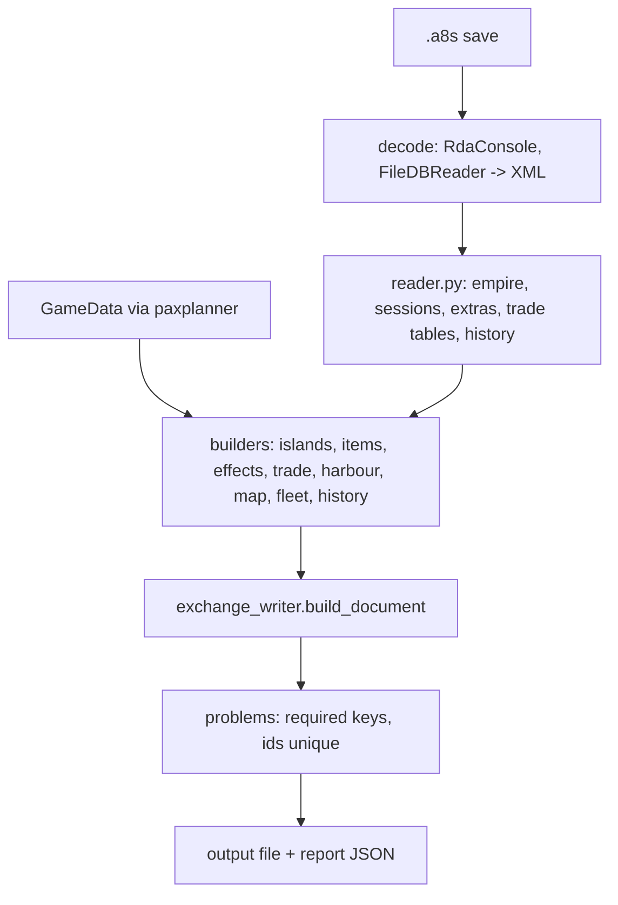

# Layout Tool Savegame Exchange Writer - Plan

## Goal Capsule

- **Objective:** The savegame script in `Anno-117-Layout-Tool/tools/savegame_to_planner` writes the exchange format
  from a `.a8s` savegame, as the first third-party-style writer: facts and topology only, no amounts computed from a
  tool's own model (R51).
- **Authority:** Taludas owns the layout repo and decides this plan. The requirements in
  `docs/spec/exchange-format-requirements.md` rank above it; a conflict goes back to the requirements. Status of the
  plan: proposal for Taludas; open decisions are listed in "Open decisions" and each blocks the unit named and every
  unit that depends on it.
- **Repos:** `Anno-117-Layout-Tool` (units L1-L10); the specification repo `anno-117-exchange-format`, whose schema,
  fixtures and tag come from unit U0 of the calculator plan (`calculator-implementation-plan.md`); and the exchange repo
  (this repository, `anno-117-savegame-exchange-format`, which holds the requirements, the analysis and the config
  updater), where L2 and L6 change `scripts/calculator_config/*` and replace `scripts/savegame_to_planner/` with a pointer.
  File paths are relative to the layout repo unless marked *(spec repo)* or *(exchange repo)*.
- **Stop and ask when:** the script has to import something other than `paxplanner.model.gamedata` from the planner
  repo (decision LD1); a dependency has to be added (L1 proposes `jsonschema` as a dev dependency); or a field the
  catalog does not list has to be written outside `ext.anno117-layout-tool`.
- **Execution profile:** pure functions over decoded save tables, written test-first with pytest. Tests that need a
  save are marked `needs_save` and skip through `pytest.skip` on missing environment variables, as
  `tests/test_savegame_decode.py` in the exchange repo does (`ANNO_DECODED` for decoded XML, `ANNO_LAYOUT_REPO`,
  `ANNO_TEXTS`); a fresh decode of the `.a8s` additionally needs `ANNO_RDACONSOLE` and `ANNO_FILEDBREADER`. The layout repo
  has no `pyproject.toml`, so L1 registers the markers.
- **Tail:** no push, no release, no commit of decoded save data or `.a8s` files.

## Product Contract

### Summary

The script reads a `.a8s` savegame and writes an exchange file with islands, building counts per GUID, patrons,
devotion, fertilities, items per villa and officium with position, applied radius effects with share and method,
disabled needs, harbours, map identity, fleet, research, route configurations, recorded visits, minimum stock levels,
derived good flow (as estimate, with basis) and history. A file validates against the specification schema and imports
into the planner and the calculator.

### Requirements in scope

| Requirement | Writer behavior | Units |
| --- | --- | --- |
| R18, R19, R21 | Valid minimal file; island ids; game island reference with area key | L3 |
| R22 | `source` block | L7 |
| R8 | Vendored schema and fixtures | L1 |
| R29 | Island name from `CityName`, else the text behind `CityNameGuid`, else a placeholder; display text only | L3 |
| R23, R24 | Fertilities present or missing with completeness flag; per-building counts for every GUID; `population` informational | L3 |
| R25, R55 | `itemHolders[]` and exact `moduleAttachments[]` by owner instance | L4, L5 |
| R26, R36 | Range-only `appliedEffects[]` with share, applied flag, method, scale; `rangeBuffs`; documented rules | L5 |
| R27, R32-R35, R37, R49, R51, R54 | Route configurations, ships, visits, minimum stock; reference derivation of `trade.imports` with the `default` flag and tie-break; basis flags | L6 |
| R43 | `disabledNeeds` from pause data per population level | L3 |
| R39, R44 | `research` with basis "researched"; global effects from the save | L7 |
| R40, R41, R31, R42 | Harbour, map settings, island position, map file stem, fleet | L7 |
| R28 | History period snapshots; storage trends only when the time axis is verified | L8 |
| R20 | Conformance fixtures, shared with the other two tools | L1, L9 |
| R10, R11, R13 | GUID identifiers; unknown or unmodelled save content in `ext.anno117-layout-tool` | L3-L8 |
| R53 | Not applicable: R53 is a rule for a calculator config updater (see "Decisions assigned elsewhere") | none |

Acceptance examples that apply: AE6, AE7 (form: two islands named alike keep different references), AE10-AE19 (AE11, AE18
and AE19 as source side or form: they describe a tool that imports and exports), AE20 (reader behavior; the writer records
`minimumStock` on the island, L6), AE21 (source side: the sawmill count as read from the save), AE25.
The success criteria of the origin that concern the script: `Marcia 69.a8s` validates and imports into both tools; the
street rule reproduces the Star-of-the-Nile library observation.

### Scope Boundaries

**Deferred for later**

- Content of `layout` (building positions, roads, fields of the layout tool): stays in
  `ext.anno117-layout-tool` and is not part of the exchange catalog.
- Street-distance validation beyond one island; walkway and bridge hop costs (documented as assumptions in the
  script README).
- Reading `.a8s` files in the planner or the calculator.

**Outside this work**

- Changes to the layout tool GUI (`main_qt.py`, `canvas_widget.py`, `savegame_parser.py` importer); changes to the
  planner and the calculator.
- Writing a calculator storage dump: the config updater in the exchange repo keeps producing calculator dumps; only its
  readers and its trade derivation move to the shared code (L2, L6).

## Planning Contract

### Key Technical Decisions

- KTD1. **One writer module set inside `tools/savegame_to_planner/`, directory name unchanged for now.** The exchange
  repo's tests and scripts import `savegame_to_planner` through `ANNO_LAYOUT_REPO`; renaming it moves that dependency
  (decision LD5). New code goes into `exchange/` next to the existing script.
- KTD2. **Readers first, writers pure.** The decode chain and the XML readers stay in
  `savegame_to_planner.py` until L2 moves them into `reader.py`. Every writer function takes decoded tables and returns
  a JSON-able dict, so conformance tests need no save.
- KTD3. **No amounts from a model.** The planner-format writer computes t/min amounts with `paxplanner` `Engine`
  (`derive_trade` uses `Engine.solve_island` only for the demand that scales amounts). The exchange writer never does:
  `trade.imports` carries topology, shares as estimates, and the basis (R51). With three small refactors this removes
  every use of `Plan`, `IslandPlan`, `FactorySettings`, `ItemSlot`, `Engine` and `routes`: `derive_production` and
  `derive_harbour` return plain records or tuples instead of building `FactorySettings` and `ItemSlot`, and
  `optional_ship_effects` (`paxplanner/model/routes.py:274`, reads only `data.ships`) is copied into the script. Only
  `GameData` remains (LD1). L5 does the `derive_production` refactor, L7 the `derive_harbour` refactor and the copy of
  `optional_ship_effects`; `Plan`, `Engine` and `routes` stay imported only by the `--format planner` path until L10.
- KTD4. **Island id is `a<areaKey>`.** It is stable across saves of one game and unique in a file, as today
  (`build_plan`). The format treats ids as opaque (R21); the game reference carries the structure.
- KTD5. **Range effects and attached modules are separate facts.** `appliedEffects[]` contains only effects applied by
  range and stores share, writer decision and method (`circle`, `street` or `circleFallback`). `moduleAttachments[]`
  records exact `ModuleOwner` relations per instance (R55). A planner-format projection may use strict majority for its
  type-wide module flag, but that projection never replaces the attachment records.
- KTD6. **Derived flow is a pure function of the route tables.** `derive_imports(routes, visits, minstock, ...)` lives in
  one module and is the single implementation in the layout repo. `scripts/calculator_config/trade_derive.py` in the
  exchange repo is a re-derivation of `derive_trade` (it adds diagnostics and per-route edges), not a byte copy; after L6 it
  calls the shared function. The rule changes with it (decision LD9).
- KTD7. **Unknown or unmodelled save content goes to `ext.anno117-layout-tool`.** Station markers (`VanishGoods`,
  `StationID`, `HasTradeRights`, `TargetStationID`) are written in the station's own `ext.anno117-layout-tool` block inside
  `trade.routes[]` (origin Key Decision). Layout content (positions, roads, fields) is deferred and not written. Document-scope
  writer settings such as the street mode (LD3) live in `ext.anno117-layout-tool` at document scope.
- KTD8. **Schema validation in tests only.** The script validates required keys itself and reports problems;
  `jsonschema` runs against the vendored schema in pytest (LD6).

### Assumptions

- The specification repo is tagged `v1.0.0` before L1 starts, with the reference derivation rule (LD9) and its conformance
  fixtures settled before the tag; `Marcia 69.a8s` and the decode tools are available to the person running `needs_save`
  tests. Unit tests without `needs_save` still need a planner checkout for `GameData` (`ANNO_PLANNER_REPO`).
- The planner repo is checked out next to the layout repo (`--planner-repo`, `ANNO_PLANNER_REPO`) for `GameData`.
- Player participant id is 41 as in the existing script (`HUMAN_PROFILE`); other participants are traders.

### Open decisions

| ID | Question | Recommendation | Blocks |
| --- | --- | --- | --- |
| LD1 | The script imports `paxplanner` (`GameData`, `Plan`, `Engine`, `routes`). Keep the dependency on `paxplanner.model.gamedata.GameData` only, ship an own game-data layer, or read the extractor JSON directly? | Keep `GameData` only (building -> factory, populationLevel, fertility regions, item scopes, boosts, harbours, needs, techs, maps, session region); drop `Plan`, `IslandPlan`, `FactorySettings`, `ItemSlot`, `Engine` and `routes` through the three refactors of KTD3. `GameData` is DLC-filtered (residences and levels shrink from 14 to 9 with DLC 3 off), so the writer keeps raw GUIDs and pairs that `GameData` lacks (R38). Document that the planner checkout is needed for game data, not for plan logic. | L3 |
| LD2 | Visit weight: the script counts distinct visit timestamps (min 1) times unload amount; R32 says visits per time times unload slots times slot amount. | Supported in direction by the analysis (`evaluate_split.py` test B divides by a per-route span; the 0.23 headline is test A, raw counts, normalised within one route). Record the window per island and route from its own first and last entry (the save keeps at most 31 entries per island and route, so a count saturates and the window cannot be taken from the save), use visits per hour, filter `Trader == 41` (the script ignores `Trader` today; 253 of 1605 entries are other traders), and define the rule for a route with no history (today `max(1, count)`). Re-measure the accuracy with the final rule. | L6 |
| LD3 | Street mode default: `euclid` (walked length, R36) or `layout`. | `euclid` default, `layout` stays an option; the mode is recorded in `ext.anno117-layout-tool` at document scope (the catalog's `source` block and the effect `method` have no field for it). | L5 |
| LD4 | Storage trends (`StorageTrends`, 120-point ring, order unverified) in version 1. | Not written until the time axis is verified (origin Key Decision); write period snapshots only. | L8 |
| LD5 | Rename `tools/savegame_to_planner` to `tools/savegame_to_exchange`, keep both, or keep the name. | Keep the name until the planner imports exchange files, then rename and leave a thin `savegame_to_planner.py` shim that points to the new entry. | L10 |
| LD6 | Add `jsonschema` as a dev dependency of the layout repo (it has no `pyproject.toml`; `requirements.txt` has Pillow, PySide6-Essentials, numpy). | Add a `requirements-dev.txt` with `jsonschema` and `pytest`; no runtime dependency. | L1 |
| LD7 | Where do shared readers and the derivation live: the layout repo (exchange repo imports them) or the exchange repo (layout imports)? | Layout repo, because `scripts/calculator_config/extract_save.py` and `tests/test_savegame_decode.py` in the exchange repo already import it via `ANNO_LAYOUT_REPO` and the layout repo ships the script. Switch `scripts/calculator_config/*` to the shared readers and derivation and replace the reference copy `scripts/savegame_to_planner/` with a pointer. The analysis scripts keep their own `xmlstream.py` unless Nico wants them moved (they never import the layout repo today). | L2, L6 |
| LD8 | Where in the save are the active DLCs stored, so that the writer can derive `settings.dlcs`? The planner keeps active DLCs in its settings and the save holds them; the field is not located in the script yet. | Find the field and the DLC identifiers in L7, map them to the exchange DLC keys, and write `settings.dlcs`; write nothing when the field is missing from a save (R19: absence is unknown). The calculator enables a DLC when stored counts need it (`DLC.used`); the planner reports a file DLC that its app settings have off. | L7 |
| LD9 | The reference derivation rule. R37 and R32 say every source feeds every sink and relay and the first loader in circuit order serves first; `derive_trade` and `trade_derive.py` give each sink ONE supplier, the nearest preceding source in the circuit (`max(s for s in sources if s < r, default=sources[-1])`, `savegame_to_planner.py:746`, `trade_derive.py:57`). The two rules differ on every multi-source route, and the accuracy figures in R37 were measured with the analysis scripts, not with a stated rule. | Pick the rule in `spec/format.md` with the conformance fixtures; implement it once in `derive_imports`; change the expectations of the config updater's stored results deliberately; re-measure the mean error (0.23 and 0.27 in R37) with the final rule and update R37. Settle it before the spec tag `v1.0.0`, because the vendored fixtures encode the rule. | spec tag (calculator U0), L1, L6 |
| LD10 | `source.savedAt`: no save-time field is documented; the analysis uses the last visit time as the end of the window. | Write `savedAt` only when a field is found; otherwise omit it (R19). | L7 |

### Decisions assigned elsewhere

- **R53** (move a factory default supplier to the type that has buildings) is a rule for a writer of calculator configs.
  The exchange repo's `scripts/calculator_config/build_config.py` implements it; the exchange writer has no default
  supplier to move, because a save holds no suppliers (origin, Dependencies). The calculator plan decides how it reads
  `products[p].producer`.
- **Reading `trade.routes` into `trade.imports`** when a file has no `imports` (R49) is a reader duty; whether the
  planner and calculator implement the derivation is decided in their plans.

### High-Level Technical Design

Source to catalog mapping (document scope unless marked island):

| Save content (reader) | Catalog key |
| --- | --- |
| area key, session, island id, area index (island) | `islands[].id`, `session`, `gameIsland` |
| `CityName`, `CityNameGuid` + texts (island) | `name`, `gameIsland.name` |
| building counts per GUID (island) | `buildings[g].built` |
| fertilities, region natural set (island) | `fertilities`, `fertilitiesComplete` |
| patron, devotion, `Residence7/ResidentCount` (island) | `patron`, `devotion`, `population` |
| `PopulationPauseInfo` (island) | `disabledNeeds` |
| sockets, `ItemMap`, objects, conditions (island) | `itemHolders[]` (buildings and ships, with `carried` for ship item slots) |
| `AreaItemManager/AreaSlotContainer` (island) | `itemStorage[]` |
| `MetaItemTransfer` (`GlobalItemContainer`, `MetaItems`), `ItemRacerAttributes` (document) | `account.items`, `account.transferItems`, `account.racers`, `account.race` |
| `ItemMap` entries without a container, socket or storage reference | `unlocatedItems[]` |
| Ranged `AreaEffectManager` records, objects, street graph (island) | `appliedEffects[]`, `rangeBuffs` |
| water-in-range data `AqueductConsumer/DistributorsInRange` (island) | `factories[f].aqueduct` (type-level projection by strict majority, reported) |
| `ModuleOwner` records, source and owner objects, factory `additionalModule` metadata (island) | `moduleAttachments[]`; type-level module flag only as a reported planner projection |
| trading posts, piers (island) | `harbour` |
| map template file, elements (island) | `islandFile`, `islandSize`, `position`, `settings.map` |
| `MinimumStock` (island) | `minimumStock` |
| `RouteMap`, ships, visits, passive trade history | `trade.routes[]`, `trade.visits[]` |
| derived from routes | `trade.imports[]` (basis planned or measured) |
| tech state, meta effects | `research`, `effects.global`, `fleet.effects`, `dominantPatron` |
| ship objects | `fleet.ships` |
| area history snapshots | `history[]` |
| save header | `source` |

### Sequencing

L1 -> L2 -> L3 -> {L4, L5, L6, L8} -> L7 (after L6, for the ship count per route) -> L9 -> L10 (after a planner release that
imports the format). L3 produces the minimal valid file and is the first deliverable (AE6). L4, L5, L6 and L8 are
independent of each other and add catalog keys.

## Implementation Units

| U-ID | Title | Key files | Depends on |
| --- | --- | --- | --- |
| L1 | Vendor spec, test harness | `vendor/anno117-exchange/`, `tests/conftest.py`, `requirements-dev.txt`, `pytest.ini` | spec `v1.0.0` |
| L2 | Reader module and shared XML helpers | `tools/savegame_to_planner/reader.py` | L1 |
| L3 | Envelope, islands, buildings, fertilities, needs, names | `tools/savegame_to_planner/exchange/document.py` | L2 |
| L4 | Item holders | `.../exchange/items.py` | L3 |
| L5 | Applied effects, range buffs, module attachments, aqueduct flag | `.../exchange/effects.py` | L3 |
| L6 | Trade: routes, ships, visits, minimum stock, derived flow | `.../exchange/trade.py` | L3 |
| L7 | Research, global effects, harbour, map, fleet, source | `.../exchange/settings.py` | L3, L6 |
| L8 | History | `.../exchange/history.py` | L3 |
| L9 | CLI, report, size handling, README, conformance | `.../savegame_to_planner.py`, `README.md`, `tests/` | L4-L8 |
| L10 | Retire the planner-format output | `.../savegame_to_planner.py` | L9, planner import |

### L1. Vendor spec, validator, test harness

**Goal:** A pinned copy of schema and fixtures, and a test harness that validates writer output.
**Requirements:** R8, R20; KTD8.
**Dependencies:** specification repo tag `v1.0.0`.
**Files:** `vendor/anno117-exchange/schema.json`, `vendor/anno117-exchange/fixtures/**`,
`vendor/anno117-exchange/VERSION`, `requirements-dev.txt`, `pytest.ini` (markers `needs_save`, `slow`), `tests/conftest.py`.
The folder is written and checked by the single vendoring script of the specification repo
(`python <spec checkout>/scripts/vendor.py --dest vendor/anno117-exchange [--check]`, calculator unit U0), so the layout repo
carries no sync script of its own.
**Approach:** Mirror the exchange repo: markers are registered in its `pyproject.toml` (not in `conftest.py`) and tests skip
through inline `pytest.skip` on environment variables. The layout repo has no test directory and no `pyproject.toml`;
this unit creates the directory and `pytest.ini`.
**Test scenarios:**
- `vendor.py --check` prints no diff after a vendor run.
- The vendored schema loads in `jsonschema`; fixtures are validated and used by the conformance test of L9, not by a second test here.
**Verification:** `python -m pytest tests -q`; the vendoring check.

### L2. Reader module and shared XML helpers

**Goal:** One copy of the XML stream helpers and of every save reader, importable by the writer and by the exchange
repo's scripts.
**Requirements:** R29 (reader side), KTD2, KTD6, LD7.
**Dependencies:** L1.
**Files:** `tools/savegame_to_planner/reader.py` (moved: `Node`, `stream`, `pairs`, `u32`, `f32`, `i32`, `utf16`,
`read_empire`, `read_session`, `read_session_extra`, `load_texts`, `decode_save`, `session_guids`), extended once with
what the exchange repo's `docs/analysis/derived-trade-flow-accuracy/scripts/extract_trade.py` reads beyond them
(`extract_routes`, `extract_sessions` are not moved: they would leave two RouteMap parsers side by side; the analysis
`Tables` are rebuilt from the shared readers or declared frozen evidence); `tests/test_reader.py`; *(exchange repo)* `scripts/calculator_config/*` import from
the layout repo (`extract_save.py` already does, through `common.add_layout_repo_to_path`). `scripts/savegame_to_planner/` in
the exchange repo is a byte-identical reference copy of the layout script with a `NOTE.md`; it is replaced by a pointer so it
cannot go stale. The layout `Node` has `all()`, `pairs`, `f32` and `utf16`, which the exchange repo's `xmlstream.py` lacks, so
the layout version is the one that moves (LD7).
**Approach:** Move code, do not rewrite it. `savegame_to_planner.py` re-imports from `reader.py`, so the planner-format
output keeps working until L10. Extend the readers with what the catalog needs and the script does not read yet:
`Residence7/ResidentCount`, `ConditionManager` boost conditions, `RadiusEffectRangeBuffs`, `MinimumStock`, object height,
`IsBoostedItem`, `PassiveTrade/History` goods with signed net amounts, trader id and ship type, route `ManuallySaved`,
`HasTradeRights`, `VanishGoods`, `StationID`, `TargetStationID`, ship slot counts, `SessionFileVersion`,
`EconomyStatisticManager` snapshots. A save-time field is not read: none is documented (LD10).
**Patterns to follow:** `X/tests/test_savegame_decode.py` for the save-dependent tests.
**Test scenarios:**
- Reader output on `Marcia 69.a8s` equals the planner-format output before the move (22 islands, same counts).
- The planner-format output of the script is unchanged by the move (golden file on the sample save).
- `scripts/calculator_config/extract_save.py` and `tests/test_savegame_decode.py` in the exchange repo run against the moved readers.
**Verification:** `pytest tests/test_reader.py -m needs_save`; exchange repo `pytest -q` with `ANNO_LAYOUT_REPO` set.

### L3. Envelope, islands, buildings, fertilities, needs, names

**Goal:** The smallest valid file plus the island core inputs.
**Requirements:** R18, R19, R21, R23, R24, R29, R43, R10, R13.
**Dependencies:** L2; decision LD1.
**Files:** `tools/savegame_to_planner/exchange/document.py`, `tests/test_document.py`.
**Approach:** `build_document(empire, sessions, texts, gamedata, options)` returns the envelope: `format`,
`formatVersion`, `generator {name: "anno117-layout-tool", version}`, `name`, `islands[]` (`source` is written by L7). Per island: `id`
`a<key>`; `session`; `gameIsland {sessionGuid, islandId, areaIndex, areaKey, name?}` (islandId `(key>>6)&127`, area
index `key>>13`, region code `key & 63` with the writer's own table `{1: "Roman", 3: "Celtic", 4: "Egyptian"}` compared with
`GameData.session_region(session)`, which returns a region name and no number; the script masks no low bits today); `name` by R29 (hand-typed
`CityName`, else texts, else the placeholder of `build_plan`); `buildings` from `area["counts"]` for every GUID,
`built` only (no `planned`, no `fullyUtilize`: a save holds neither); `fertilities` as present GUIDs explicitly true
plus the region's natural set explicitly false when the save lacks it, with `fertilitiesComplete` true only when the
region's natural set is known to `GameData`; `patron` and `devotion` unrounded; `population` from `ResidentCount`;
`disabledNeeds` (written for every island, an empty object when nothing is paused, R43) from `area["paused"]`, the `(product, level)` pairs: `derive_disabled_needs` already returns `{level: needs}`
per level (nothing is folded today) but needs the DLC-filtered `GameData.residence_by_level[level]["needs"]` and
`needs[need]["product"]`, so pairs for a level or need that `GameData` lacks are dropped silently by that function. The writer therefore derives
`disabledNeeds` from the raw pairs with an unfiltered level-to-needs table (read as data from the planner checkout's
`paxplanner/data/game/` files, `population.json` and the needs table, as planner KTD11 does, not through the DLC-filtered `GameData`) and writes every pair into core `disabledNeeds`,
including levels and needs `GameData` lacks (R38, R43: the calculator would otherwise read those needs as on); the report lists
them as carried through. Unknown GUIDs are written as they are (R38).
**Execution note:** Test-first; the minimal-file scenario is the first test.
**Test scenarios:**
- Only `format`, `formatVersion`, `generator.name` and islands with ids validate (AE6).
- A renamed island resolves to its `CityName`; a default-named one to the text behind `CityNameGuid`; an island with
  neither gets the placeholder; two islands named "f" keep different ids and game references (AE7 form).
- Building counts for a GUID unknown to `GameData` stay under `buildings` (AE18 form).
- Cinis in `Marcia 69.a8s` lists the sawmill with its save count (AE21 source side; the calculator maps it).
- A fertility the save lacks is written `false` only when the set is complete; otherwise it is absent (R23).
- Disabled needs for Cinis equal the planner-format `disabled_needs` of the previous output, per level.
- Output validates with `jsonschema` against the vendored schema.
**Verification:** `pytest tests/test_document.py`; `needs_save` golden check on `Marcia 69.a8s`.

### L4. Item holders

**Goal:** Items per villa, officium, hippodrome and other item-bearing buildings (R25).
**Requirements:** R25.
**Dependencies:** L3.
**Files:** `tools/savegame_to_planner/exchange/items.py`, `tests/test_items.py`.
**Approach:** From `sockets`, `ItemMap` and `objects`: `itemHolders[]` entries with building GUID, instance id,
position `{x, z, y?}` in game tile units, rotation in radians (absent when zero), and per item `{item, slot, boosted,
boostConditionMet}`, each only when known (`boostConditionMet` from `ConditionManager`, key
`ItemBoost_<item>_<id>`). The coordinate system is the one `spec/format.md` names. Beyond sockets (R56): ships with
`PropertyTradeRouteVehicle` become holders with `kind: "ship"`, the route id and `carried` records from their item slots
(slot kind 2; kinds 1 and 3 are product cargo and embarked units, not items); `AreaItemManager` stacks become `itemStorage`
records (one record per instance, instances of one stack share `slot`); `GlobalItemContainer` stacks become
`account.items`, `MetaItems` becomes `account.transferItems`, and `ItemRacerAttributes` of the player's participant becomes
`account.racers` and `account.race`. `MythicEffectsVector` sets `mythicEffect` on the socketed item. Every `ItemMap`
instance id is placed in exactly one list; an instance that no container or socket references goes to `unlocatedItems`.
Objects of other participants are skipped; the player's objects carry no `OwnerProfile` or the value 41.
**Test scenarios:**
- On `Marcia 69.a8s` every `ItemMap` instance referenced from the player's sockets, ships, areas or account storage, and every unreferenced instance, appears exactly once across `itemHolders[].items`, `itemHolders[].carried`,
  `itemStorage`, `account.items` and `unlocatedItems`, and the per-place counts are reported (AE26).
- A villa with two items, one boosted with its condition met: all fields present and read back equal (AE10).
- An item whose condition is unresolved has no `boostConditionMet`.
- A holder with rotation zero has no `rotation` key.
**Verification:** pytest scenarios; spot check against the planner-format `residence_items` of the same island.

### L5. Applied effects and range buffs

**Goal:** Range effects with share, decision and method (R26, R36), plus exact attached module ownership (R55).
**Requirements:** R26, R36, R55; KTD5; LD3.
**Dependencies:** L3.
**Files:** `tools/savegame_to_planner/exchange/effects.py`, `tools/savegame_to_planner/README.md` (section "Effects and modules configured on production buildings"), `tests/test_effects.py`.
**Approach:** `in_range` and `decide` are closures inside `derive_production` (`decide` returns None, appends to a
decisions list and applies the result to a `FactorySettings`); lift them to module level, keep `StreetNet` (already top
level) and the majority projection (`applied = affected * 2 > total`, `savegame_to_planner.py:537`), and emit
`{type, effect, sourceKind, share: {affected, total}, applied, method, scale?}`. Today `method` exists only for street
scope and stays "street" when the footprint is unknown (the circle fallback is only a note string, `in_street` 524-528), so
`circleFallback` is new; `scale` needs `ScalingFactor`, which `read_session` does not read, and is omitted until it is.
The planner-format output keeps working by calling the lifted functions. Do not pass `ModuleOwner` scope through
range geometry. Emit each attachment as `{building, instance, module, moduleInstance}` in `moduleAttachments[]`, validating the module
against the factory type's `additionalModule`. `factories[f].aqueduct` is written per factory type from the water-in-range data (`AqueductConsumer/DistributorsInRange`) as a
type-level projection by strict majority, which the report states (R26: water availability is a factory option, not a radius
effect). `rangeBuffs` comes from `RadiusEffectRangeBuffs` in percent per source
building type. The README names the
in-game observation (library on Star-of-the-Nile Nome: 49 targeted, 48 reached, the unreached one a Vintner) and the
remaining assumptions (walkway and bridge hop costs, Latium and Albion untested).
**Test scenarios:**
- 5 of 8 Bakeries in range of a granary effect: one entry, share 5/8, applied; 4 of 8: not applied (AE12).
- Five of eight farms of one type with water in range: `factories[f].aqueduct` true and the report names the projection; four of eight: not written as true.
- One of three same-type farms has an attached silo: preserve owner and module instance ids and the module GUID in `moduleAttachments`; do not emit a radius effect; the planner projection stays off and the report states the majority projection (AE25).
- A type without footprint gets method `circleFallback` and the circle share.
- Street mode `layout` yields `method: street` computed with the layout metric, with the same record shape; the mode is recorded in `ext.anno117-layout-tool` at document scope, because `method` allows only `circle`, `street` and `circleFallback` (LD3).
- Library on Star-of-the-Nile Nome in `Marcia 69.a8s`: 48 of 49 reached, the unreached building is a Vintner
  (`needs_save`).
- The decisions of the planner-format output for `Marcia 69.a8s` equal the new records' `applied` values (regression).
**Verification:** pytest; `needs_save` check.

### L6. Trade: routes, ships, visits, minimum stock, derived flow

**Goal:** Trade carries configurations, recorded information and a derived flow with its basis.
**Requirements:** R27, R32, R33, R34, R35, R37, R49, R51, R54; KTD3, KTD6, KTD7; LD2, LD7, LD9.
**Dependencies:** L3; the conformance fixtures of the trade constellations (spec repo U0).
**Files:** `tools/savegame_to_planner/exchange/trade.py` (`build_routes`, `build_visits`, `build_minimum_stock`,
`derive_imports`), `tests/test_trade.py`.
**Approach:** `trade.routes[]` as the game has them: id, name, stations in circuit order (island id, cargo slots with
product, mode, slot index, slot amount), ships `{type, slots, modules}`, manually-saved flag; stations on non-player
areas are written as stations without an island id and kept (the readers drop them for flow, R37); the station markers
`VanishGoods`, `StationID`, `HasTradeRights` and `TargetStationID` go into the station's own `ext.anno117-layout-tool`
block (KTD7). `trade.visits[]` with
route id, island id, trader id, time and clock, ship type, goods with net amounts (zero nets absent). `minimumStock` per
island and good (R34); never on a station. `derive_imports` follows the reference derivation of the specification:
roles from slot modes (net-amount signs when every stop loads and unloads), every source feeds every sink and relay,
first loader in circuit order, weight shares as estimates, `basis: planned` from the configuration and `measured` when
built from visits over a stated window (R33), the `default` flag on the largest-weight supplier with ties broken by
the lexically smallest island id when at least one supplier carries a share (R54), and no import-level amount where the demand is
unknown (the `default` supplier then covers the remainder). Routes
without ships carry no flow; legs to non-player stations are dropped from the flow. The function replaces the re-derivation
`scripts/calculator_config/trade_derive.py` of the exchange repo, which calls it after this unit; `derive_trade` stays frozen
for `--format planner` until L10. This is a change of rule, not a move: both existing implementations give a sink one supplier (the nearest
preceding source), net-sign roles for routes where every stop loads and unloads, the `measured` basis, the `default` flag and
the tie-break by island id exist in neither, and the weight uses the visit window (LD2, LD9). `derive_imports` supersedes
`derive_trade` for the exchange path only: `derive_trade` stays, frozen, for `--format planner` until L10. The writer never
writes a supplier-level `amount` (that field is a user-entered minimum, R51); a measured or planned t/min goes only to the
import-level `amount` with its basis, and a writer without a known demand omits it. `derive_imports` exposes
`station_roles(route)` so `scripts/calculator_config` and the analysis `common.roles` can call it or be listed as frozen.
**Execution note:** Test-first with the R35 fixture set; each constellation is a scenario.
**Test scenarios:**
- Dates distribution (source, three load-and-unload stops, unload-only sink): route keeps order and slot modes, flow
  lists the source as supplier for the four other islands with share 1 (AE13).
- Two sources at a 2:1 weight: shares two thirds and one third, largest flagged default (AE14).
- Flow from recorded visits states `measured` and the window; amounts match the visits (AE15).
- Two routes serving one island and good: one `minimumStock`, no level on a station (AE16).
- A route whose station order differs from ascending station ids keeps the file order (AE17).
- Route without ships, route with only non-player stations: no flow entries, routes still written.
- Same sink visited twice, relay with net zero, bidirectional circuit: output equals the fixture expectation.
- On single-source routes the derived output equals `trade_derive.derive` on the stored `fx_report` inputs; on multi-source
  routes the expectations are the fixtures of the final rule (LD9), and the differences to the old results are listed.
- Visits of another trader (`Trader` not 41) do not enter weights or windows.
- No supplier entry in any written import carries `amount`.
- Each remaining constellation of R35 has a scenario against the spec fixture: point to point, manual one-slot route, distribution across sessions, multi-source collection, good loaded but never unloaded, shared supply of one island and good by two routes.
**Verification:** pytest; a new test in the exchange repo that runs `build_config.py`'s trade step through the shared function
(`tests/test_trade_analysis_results.py` only reads stored CSV files and does not exercise the derivation).

### L7. Research, global effects, harbour, map, fleet, source

**Goal:** Document-scope settings and island placement.
**Requirements:** R22, R31, R39, R40, R41, R42, R44; LD8, LD10.
**Dependencies:** L3, L6 (the number of ships per route comes from the route tables).
**Files:** `tools/savegame_to_planner/exchange/settings.py`, `tests/test_settings.py`.
**Approach:** `research {basis: "researched", researched, counts, queue}` from `MetaTechHandler`; knowledge per minute
is absent. `effects.global` holds the meta effects of the player that are neither discoveries nor patron-derived
(R39). `dominantPatron`. `fleet.effects` for the optional ship effects found in `meta_effects`; `fleet.ships` from the
ship objects (type, modules, captain item) with the number per route. `harbour {warehouse, spots, item?}` from
`derive_harbour` (trading post GUIDs, piers; this unit refactors it to return a plain `(guid, boosted)` tuple instead of an
`ItemSlot`, and copies `optional_ship_effects` from `paxplanner/model/routes.py:274`, KTD3). `settings.map` with template or map file and expansions; per island
`islandFile`, `islandSize` and `position` as a slot on a planner template or the map element index and `x`, `z` for a
campaign map, with the reliability of a derived slot stated in the spec. `source {kind: "savegame", file,
saveFormatVersion (SessionFileVersion), gameVersion?, savedAt?}`. `settings.dlcs` comes from the save's DLC field (LD8).
**Test scenarios:**
- `research.basis` is "researched" and a repeatable discovery researched five times has count 5 (AE19 source side).
- A Latium island on the campaign map has `islandFile` equal to the stem and `position` as element index and
  coordinates, no slot.
- An Aegyptus island has the template slot from the stem lookup.
- The harbour of an island with trading post and two piers records warehouse GUID and `spots`.
- `source` has file name and save format version.
**Verification:** pytest; `needs_save` check on `Marcia 69.a8s`.

### L8. History

**Goal:** Carry recorded history as the save holds it (R28).
**Requirements:** R28; LD4.
**Dependencies:** L3.
**Files:** `tools/savegame_to_planner/exchange/history.py`, `tests/test_history.py`.
**Approach:** `history[]` series from `EconomyStatisticManager/History/areaHistory` snapshots: island id, product, kind
(storage, production, consumption), `clock: "game"`, unit, start, step (600,100 ms in the sample) and values. Generation
and consumption units are written as the save states them; whether they are per minute is unverified and is recorded in
`unit` as "unverified" until settled. Storage trends are not written (LD4). `history.py` takes a size budget parameter; when
the file exceeds it, whole series are dropped in a stable order, never truncated (L9 only wires `--max-size` to it).
**Test scenarios:**
- A storage series for Bread keeps clock, unit, start, step and values (AE11 source side).
- The writer with a size budget drops entire series in a stable order and reports each dropped series.
- A save without history writes no `history` key.
**Verification:** pytest; `needs_save` check.

### L9. CLI, report, size handling, README, conformance

**Goal:** One command writes a valid, documented file; the suite proves it against the shared fixtures.
**Requirements:** R20, R29; AE6 form (a report of what the save did not provide).
**Dependencies:** L4-L8.
**Files:** `tools/savegame_to_planner/savegame_to_planner.py` (`--format exchange|planner`, `--max-size`),
`tools/savegame_to_planner/README.md`, `tests/test_conformance.py`, `tests/test_marcia69.py`, `README.md` (pointer).
**Approach:** `--format exchange` is the default once L9 lands; `--format planner` keeps the previous output until L10.
The report JSON keeps its decisions and gains a "not provided" list per optional area (AE6 form). The README documents
the CLI, the dependencies on RdaConsole, FileDBReader and the planner repo's `GameData`, the street rule and the
observations it was validated against, the weight rule and the basis flags.
**Test scenarios:**
- `Marcia 69.a8s` output validates against the vendored schema (`needs_save`).
- 22 islands, game references unique, building counts equal the planner-format `residences` and `existing` folded back.
- The output imports into the calculator and the planner (manual check, then the exchange repo's cross-tool test).
- A file written with `--max-size` below the history size has no truncated series.
- Conformance: for every vendored valid fixture that describes savegame content (the minimal file, the trade constellations, the Cinis island, unknown identifiers), the writer's output for the matching decoded input equals the fixture's expected block; fixtures that describe reader behavior (unknown generator, newer minor version, preserved fields) are outside the writer's reach and are run by the readers' tests.
**Verification:** `python -m pytest tests -q`; manual run with the save.

### L10. Retire the planner-format output

**Goal:** One output format.
**Requirements:** none of its own; follows LD5.
**Dependencies:** L9 and a planner release that imports the format.
**Files:** `tools/savegame_to_planner/savegame_to_planner.py`, `derive_trade` and planner-only builders removed.
**Approach:** Remove `build_plan` and the `Plan`, `IslandPlan`, `Engine` imports; decide the rename (LD5).
**Test scenarios:**
- The planner imports the script's output and shows the savegame's islands with their built counts (F2).
- No import of `paxplanner` other than `GameData` remains.
**Verification:** grep for `paxplanner` imports; full test run.

## Verification Contract

Run from the layout repo root.

| Gate | Command |
| --- | --- |
| Unit tests | `python -m pytest tests -q -m "not needs_save"` |
| Save tests | `python -m pytest tests -q -m needs_save` (needs `ANNO_DECODED` or, for a fresh decode, `ANNO_RDACONSOLE`, `ANNO_FILEDBREADER` and the save) |
| Vendored spec | `python <spec checkout>/scripts/vendor.py --dest vendor/anno117-exchange --check` |
| Exchange repo | `pytest -q` there, with `ANNO_LAYOUT_REPO` set |

## Definition of Done

- The script writes a file for `Marcia 69.a8s` that validates against the vendored schema and imports into the
  planner and the calculator.
- Every catalog key in the source-to-catalog table is written or listed as not provided in the report.
- After L10: the trade derivation exists once; XML readers and the trade derivation exist once for the layout script and
  `scripts/calculator_config` (the analysis scripts are excluded unless LD7 moves them).
- The street rule's observation and assumptions are in the script README.
- Planner-format output is gone or documented as transitional.
- `.a8s` files and decoded data are not committed; `tools/` is under version control.

## Risks and Dependencies

- **Spec first.** The catalog and the reference derivation rule must be fixed (calculator plan U0, Taludas review) before the
  tag, which precedes L1.
- **Planner dependency for game data.** The script cannot run without a planner checkout (LD1). Mitigation: only
  `GameData` is used; a later change can move the game data into the exchange repo.
- **Untracked script.** `tools/` is untracked and the repo has no tests or CI; L1 creates the test directory and the
  first commit of `tools/` is part of L2.
- **Unverified time axes and units.** Storage trends are not written (LD4); generation and consumption units are
  marked unverified.
- **Weight and supplier rule.** The timestamp-count weight is not the spec's visits per time (LD2), and the nearest-source
  rule is not the spec's every-source rule (LD9); the accuracy figures (mean error 0.23 against recorded flows) belong to the
  old computation and are re-measured with the final rule. Shares are estimates either way.
- **Single-island street validation.** The street rule is validated on one island (R36).

## Sources and Research

- Survey of the layout repo: `tools/savegame_to_planner/savegame_to_planner.py` (`read_empire`, `read_session`,
  `read_session_extra`, `build_plan`, `derive_production`, `StreetNet`, `derive_trade`, `derive_harbour`,
  `derive_disabled_needs`, `derive_position`), `savegame_parser.py`, `canvas_widget.py` (layout model).
- Exchange repo: `docs/findings/savegame-structure.md`, `docs/analysis/derived-trade-flow-accuracy/`
  (`extract_trade.py`, `common.py`), `scripts/calculator_config/` (`trade_derive.py`, `extract_save.py`,
  `build_config.py`), `tests/test_savegame_decode.py`.
