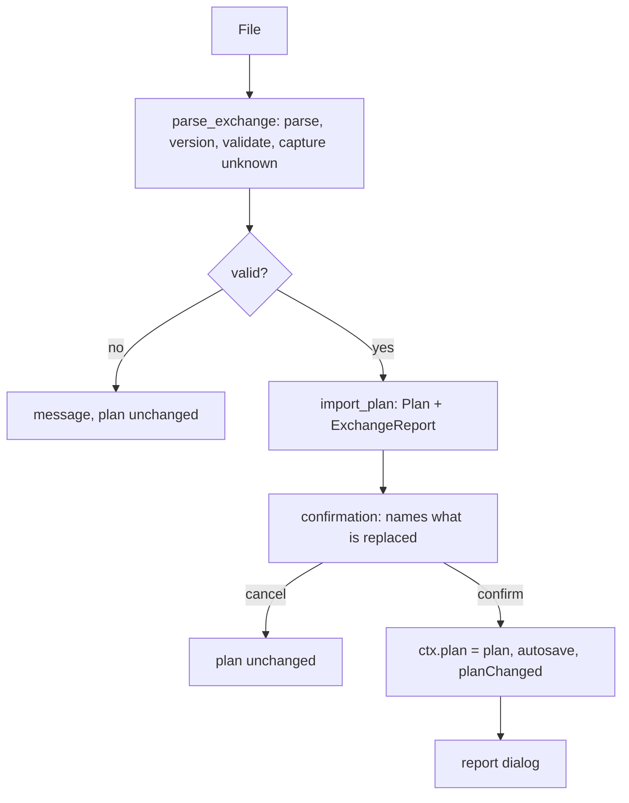

# Planner Exchange Import and Export - Plan

## Goal Capsule

- **Objective:** The Taludas Planner imports and exports the tool-neutral exchange format from its main menu, maps every
  plan field to a catalog key or to `ext.planner` (R47), preserves what it does not understand attached to its island
  (R13, R14), and fixes the wonder unlock to use the devotion summed over islands (R45).
- **Authority:** Taludas owns the planner and decides this plan. The requirements in
  `docs/spec/exchange-format-requirements.md` rank above it; a conflict goes back to the requirements. Status of the
  plan: proposal for Taludas; open decisions are listed in "Open decisions", each blocking the unit named and every unit
  that depends on it.
- **Repos:** `Anno-117-Planner` (units P0-P11) and the specification repo `anno-117-exchange-format` (schema, fixtures
  and tag from unit U0 of `calculator-implementation-plan.md`). Paths are relative to the planner repo unless marked
  *(spec repo)*.
- **Stop and ask when:** a runtime dependency has to be added (P0 proposes none; `jsonschema` is a dev dependency
  only); the plan file format `PLAN_VERSION` has to change in a way old planner versions cannot read; or a plan field
  has no destination in the catalog (R47) after the decisions below.
- **Execution profile:** model code under `paxplanner/model/` stays Qt-free and is written test-first with pytest
  (`tests/conftest.py` keeps the temp `APPDATA` and `language: english` import-order property). UI units are verified
  with offscreen Qt tests (`QT_QPA_PLATFORM=offscreen`, `AppContext` with `save_settings` stubbed, as in
  `tests/test_trade_view.py`). New UI text goes into all 12 language files (`tests/test_i18n.py`).
- **Tail:** no push, no release. Existing plan files (`PLAN_VERSION` 1) load unchanged.

## Product Contract

### Summary

Add Import and Export of the exchange format to the main menu. Import reads a file, shows a confirmation that names what
is replaced, replaces the open plan, and shows a report of what could not be mapped, what was carried through, what was
approximated and what the file did not provide. Export writes a valid file from the plan, restores preserved data and reports what it wrote. A plan
exported and imported by the planner is unchanged (R47).

### Requirements in scope

| Requirement | Planner behavior | Units |
| --- | --- | --- |
| R1, R2, R3, R4 | Menu entries, replace after confirmation, report, rejection of foreign or newer-major files | P3, P9 |
| R8, R9, R19, R20 | Vendored schema and fixtures; tolerant reader; conformance run | P0, P3, P11 |
| R10, R11, R13, R14, R15, R38 | Passthrough store per island and per document; edits win; unknown GUIDs and regions kept | P1, P4, P7 |
| R16 | Core inputs exact | P4-P7 |
| R17 (optional) | `computed` written and compared after import, when P10 is built | P10 |
| R55 | Module attachments preserved exactly; `silo` projected by majority and reported | P4, P7 |
| R52 (producer types) | A good made by several producer types keeps the type with the most built buildings; the others are preserved and reported | P4 |
| R21, R30 | Island id; game island reference stored in the plan, name fallback | P1, P8 |
| R23 | Fertilities: `false` = missing; `true` = not missing; absent = not missing unless `fertilitiesComplete` is true, then missing | P4, P7 |
| R24 | Per-building residence counts summed to levels on import; per-level counts on export | P4 |
| R25, R26, R28, R31, R41 (parts) | Preserved: item holders, applied effects, history, live, layout; map and positions mapped as far as the planner models them | P4, P6, P7 |
| R27, R32-R35, R37, R46, R49, R51, R52, R54 | Supplier mapping with the residual-supplier contract; governors; non-player islands to trade; routes preserved | P5 |
| R39, R44 | Discoveries, basis flag, volcano, seasons, wonder effects per the conversion table | P6 |
| R40, R42, R43 | Harbour, fleet, disabled needs | P4, P6 |
| R45 | Wonder unlock from summed devotion | P2 |
| R47 | Every plan field has a destination | P4-P7 |
| R50 | `materials` count and the end factory's built count with `fullyUtilize` | P4, P7 |

Acceptance examples that apply: AE1-AE4, AE5 (optional, P10), AE6, AE7 (matching by reference), AE9, AE11 (history kept as
is), AE13 (route order kept), AE14 and AE15 (reader side: residual choice and measured basis), AE18, AE19 (planner side), AE21,
AE22, AE25; flows F1-F3. AE10, AE12, AE16, AE17 and AE20 describe writer or route-station behavior and are preserved-as-is only.

### Scope Boundaries

**Deferred for later**

- Reading old-format calculator configs (stays calculator-only, origin Key Decision).
- Merging islands from a file into the open plan; opening an import as a new plan file.
- Showing imported history, live values or trade routes in the interface.
- Deriving `trade.imports` from `trade.routes`: R49 says a reader may derive; the planner does not in version 1 and reports
  the routes as preserved. Writers always write `imports` when they write `routes`.

**Outside this work**

- Changes to the calculator, the layout tool, or the savegame script.
- Planner settings that live in the app and not in the plan: sandbox setups, goods choices, solved achievements, DLC
  switches (decision PD3).

## Planning Contract

### Key Technical Decisions

- KTD1. **Qt-free modules under `paxplanner/model/`:** `exchange.py` (reader, validator, `ExchangeReport`),
  `exchange_import.py` (one `import_plan(document, gamedata) -> (Plan, ExchangeReport)` with the internal functions
  `import_islands`, `import_trade`, `import_settings`, written by units P4, P5 and P6), and `exchange_export.py`
  (`plan_to_document`). The report is plain data (carried, not mapped, approximated, not provided, differences);
  `ui/exchange_report.py` renders it. `AppContext` gets `read_exchange(path)` (reads and builds the plan and report without
  assigning), `apply_import(plan)` and `export_exchange(path)` next to `open_plan`: the plan is built before the confirmation
  and assigned only on confirm, so a cancel or a failure leaves the open plan unchanged.
- KTD2. **Passthrough as one raw record per island and per document.** `IslandPlan.ext` and `Plan.ext` hold everything
  the planner does not model: unknown island keys, `ext.<other>` blocks, unmodelled core-optional keys (`itemHolders`,
  `appliedEffects`, `rangeBuffs`, `needNotes`, `notes`, `products[].notes`, `minimumStock`, `population`, `layout`,
  `history` series, `live`), and sibling fields and entries the planner cannot model (decision PD2). Both are plain JSON
  dicts with two parts: `ext["raw"]` holds the unmodelled record as the file had it (including unknown keys inside a
  file's `ext.planner`), and `ext["planner"]` holds planner-owned bookkeeping (`exchangeId`, `moduleProjection`,
  `orphans`, `liveLinks`), so a foreign key can never collide with a planner key. Export locations: `exchangeId` becomes
  `id`, `moduleProjection` is not written, `orphans` are written into `islands[]`, `liveLinks` into `ext.planner.liveLinks`
  at document scope. Both dicts are written by `to_json` and read by `from_json`; old plan files load with empty stores.
  `PLAN_VERSION` rises to 2 and `from_json` starts to read it only to refuse a version above its own.
- KTD3. **Export is preserved record overlaid with modelled values, field by field.** The plan overlays only the fields it
  models; sibling fields of the same entry stay as preserved: `buildings[g]` takes `built` from the plan and keeps `planned`
  and `fullyUtilize` (R50: the planner preserves `fullyUtilize` and does not interpret it), except the region's end factory of
  each material, where the plan writes `built` and `fullyUtilize` per R50 and PD6; `factories[f]` takes `items`,
  `aqueduct`, `effects`, `modules` and `manualProductivity`; `products[p]` takes `producer` and keeps `notes`. An entry is
  deleted only when the plan removed every field it models and nothing else is stored in it. Outside the identifiers the
  planner can model (decision PD2) the preserved entry is written back unchanged (R15, R38). `trade.imports` is keyed by
  receiving island and product, `trade.governorHarbours` by governor GUID: a generated entry replaces the preserved entry
  with the same key; a preserved entry with no counterpart in `supplied_by` (preserved by P5) is written unchanged unless
  the plan now has its own entry for that product (edit wins, AE3) or the receiving island is deleted (PD7); a preserved
  supplier-level `amount` and `share` are re-attached by island id to the generated entry while the plan's supplier set for that
  product is unchanged, the residual supplier included (its entered minimum is the calculator's `userSetAmount` on the default
  route, CP3), and the planner derives no `amount` of its own for it. Keys with an authoritative
  identifier domain: `residencesByLevel` (levels), `buildings` (factory GUIDs, residence GUIDs), `fertilities` (the island's
  region fertilities), `disabledNeeds`, `factories`, `effects`, `patron`, `devotion`.
- KTD4. **Per-building residence entries are dropped on export** for residence GUIDs, and `residencesByLevel` is written
  (origin Key Decision). If the preserved record kept the per-building counts, R24 would make the stale counts win in the
  reader after a planner edit. The calculator reads the per-level counts through the level-to-building mapping
  (decision CP1 in the scoping synthesis).
- KTD5. **Island ids.** The plan island id is the file id when it is a non-empty string without `>` and without the
  prefix `governor:` (both are used in `routes` keys and in `supplied_by`) and unique; otherwise the planner generates an id
  (`uuid4().hex[:10]`) and keeps the file id in `IslandPlan.ext["planner"]["exchangeId"]`, which export writes back as `id`.
  References to the island in the file (`suppliers`, stations, visits, history) are remapped through the same table.
- KTD6. **Game island reference lives in the plan.** `IslandPlan.game_island` holds `{sessionGuid, islandId, areaIndex,
  areaKey, name}` with the catalog's field names (the island's own `session` stays its region key); `Plan.from_json` reads it and a settings migration moves `live_links` entries by name into it where
  the live feed has delivered a reference (P8); a link known only by game island name is stored as `game_island {name}` and
  exported only when the reference triple is present. Link modes other than one game island (`""` automatic by name, `"*"`
  whole session) go to `Plan.ext["planner"]["liveLinks"]` and to `ext.planner.liveLinks` in the file.
- KTD7. **Hand-written runtime validator, schema in tests.** `paxplanner/model/exchange.py` checks the marker, the
  version, the generator name, island ids (present, unique) and the types of the keys it reads, and never rejects unknown
  keys. The full JSON Schema runs in tests with `jsonschema` (dev dependency). Known keys with a wrong type are reported
  and skipped, not coerced, not stored (so `ItemSlot(**s)` and `WonderSettings(**v)` never see unknown keys: the reader
  builds them from named fields).
- KTD8. **Import never changes app settings.** DLC switches, language and live-feed options live in `settings.json`
  (README, "What is stored where"). A file that uses a DLC the app has off gets a report line (decision PD3).
- KTD9. **Estimates are marked.** Amounts the file derives (basis planned or measured) are used only to choose the
  residual supplier (R51, R54). Amounts with basis entered become the planner's t/min.
- KTD10. **Module attachments are projected and preserved (R55).** `moduleAttachments[]` goes to the island's `ext["raw"]`. The planner's
  `silo` flag per factory type is projected from it by strict majority (more than half of the type's built buildings carry
  the module) and the projection is stored with the planner's bookkeeping (`ext["planner"]["moduleProjection"][factory]`) and reported. On
  export the preserved attachments of a factory type are written back only while the plan's `silo` for that type still equals
  the stored projection; if the user changed it, that type's attachments are dropped, `factories[f].modules` carries the
  plan's value, and the report says so (R15).
- KTD11. **Residence levels come from an unfiltered table.** With DLC 3 off, `GameData.residences` and `levels` shrink from 14
  to 9 (`_remove_dlc_content`, `gamedata.py:383-385`), so the five Egyptian residence GUIDs would be unknown. The residence-to-level
  table for import and export is read from `population.json` before DLC filtering; levels the engine does not know stay in
  `IslandPlan.residences` (the engine skips them, `engine.py:833-836`) and the report lists them as carried through.

### Assumptions

- The specification repo is tagged `v1.0.0` before P0 starts, Taludas has confirmed the catalog, and the catalog already
  contains the rows of PD4 (`ext.planner.shipTemplates`, `.governorNames`, `.map`, `.planVersion`, `.liveLinks`,
  `factories[f].modules` for `silo`). PD4 therefore blocks the tag and P0.
- One residence building exists per population level (14 residences, 14 levels in `population.json`); the mapping is
  `population.json` `populationLevel` per residence, read unfiltered (KTD11).
- `GameData` is the game data of the installed planner version; GUIDs it does not know are reported and preserved.

### Open decisions

| ID | Question | Recommendation | Blocks |
| --- | --- | --- | --- |
| PD1 | Which wonder effects does the planner derive and write to `effects.global`? | Five of the 11 patron wonders are effects (`effects.json`, source type `patron-wonder`): Ceres 43620 (Vervactor's Plough), Cernunnos 50262 (Arboreal Rhizome), Neptune 137876, Minerva 95709, Thoth 153864. The planner writes each at scale 1 when the summed devotion of its patron reaches `religion_balancing["wonderThreshold"]` (4000), so the calculator sees them, and strips these five GUIDs from `effects.global` on import (`Engine.island_sources` adds `global_effects` and `patron_wonder_sources`, so a stored copy would count twice). The other six wonders are unlocks (`wonderUnlocks`: Mars, Mercury, Epona, Vulcanus, Isis Bubastis, Sobek), checked by `Engine.unlocked`; they are not exchanged and follow the summed devotion through P2. | P2, P6, P7 |
| PD2 | Authority domains for partly modelled maps (`buildings`, `fertilities`, `factories`, `effects`). | Domain = identifiers `GameData` models for that key (factory GUIDs, residence GUIDs, region fertilities, factory GUIDs with items, effect GUIDs the planner lists); the rest is preserved. Record the table in `spec/conversion-rules.md`. | P4, P7 |
| PD3 | DLC switches on import. | No change to app settings; report a file DLC that is off and the content ignored; export writes `settings.dlcs` from app settings. | P6 |
| PD4 | Catalog gaps from the field audit (R47). Verified in the engine: `silo` is a bool for the factory's `additionalModule` (`GameData.silo_modules` has four modules: three silos and the Egyptian dovecote); `aqueduct` enables the factory's aqueduct buffs; `effects` and `building_effects` are disjoint GUID sets (`building_effects` are the three Aegyptus "Nearby Granary" effects in `building_boosts`, `effects` the rest, two of them area boosts). | `silo` -> `factories[f].modules` containing `additionalModule`; `aqueduct` -> `factories[f].aqueduct`; `effects` and `building_effects` -> `factories[f].effects`, split on import by membership in `building_boosts`; `FactorySettings.manual_productivity` -> `factories[f].manualProductivity`; `MapSettings.dlc01` -> the expansions of `settings.map` (as in the mapping table); `ShipTemplate.id`, `name`, `boosted`, `PassiveTrade.ships`, `profile`, `GovernorSource.name`, `MapSettings.detour`, plan `version`, live-link modes, the planner's own `existing` count of a material end factory -> `ext.planner` (`shipTemplates`, `passiveTrade`, `governorNames`, `map`, `planVersion`, `liveLinks`, `materialsExisting`). Add rows to the catalog and the conversion rules before the tag. | spec tag, P0, P4, P6 |
| PD6 | Materials switched off in the planner after an import from the calculator (R50 has no off state: the calculator treats the factories as fully utilized by default). | `materials_on` false exports the end factory with `fullyUtilize: false` and `built` = `existing`; import reads `fullyUtilize: false` as materials off with `existing` = `built`. | P4, P7 |
| PD7 | Preserved document-level data that names islands (`trade.routes` stations, `trade.visits`, `history`, `live`, `minimumStock` is island scope). | On export, entries naming a deleted island are dropped (the rest of the entry is kept: a route loses that station; a preserved `trade.imports` entry whose receiving island is deleted is removed, and one whose supplier is deleted loses that supplier); the report counts them (R14, AE2). | P7 |
| PD8 | Duplicating an island: copy `ext`? | Copy `ext` (notes survive) and leave `game_island` empty, as the link is not copied today. | P1 |
| PD9 | A file island whose `session` the planner does not know (later DLC region). | Keep as an orphan in `Plan.ext["planner"]["orphans"]` with its record, write it back in `islands[]` on export (R38); no `IslandPlan` is created (the engine cannot solve it). The orphan stays until the plan is replaced; a way to remove it is not built in version 1. An island without `session` is not an orphan: its region is taken from its factory and residence GUIDs (P4), and it is orphaned with the report line "no region" only when no building identifies one. | P4 |

### High-Level Technical Design

Export builds the document from the plan (`plan_to_document`), overlays `ext` per KTD3 and writes with the same atomic
`.tmp` replace as `Plan.save`.

Mapping (field audit of `project.py`, R47). Island scope:

| Plan field | Catalog key | Rule |
| --- | --- | --- |
| `id`, `name`, `session` | `id`, `name`, `session` | KTD5 for `id` |
| `game_island` | `gameIsland` | KTD6 |
| `residences` | `residencesByLevel` | import sums per-building counts by level (R24); per-building entries dropped on export (KTD4) |
| `existing` | `buildings[factory].built` | factory GUIDs only; other buildings preserved |
| `materials`, `materials_on` | `materials` (switch and per-material counts, always written) and the region's spec-listed end factory's `built` with `fullyUtilize` | R50, PD6; where `producers` selects a different end factory, export still writes the region default and the report lists the substitution as approximated |
| `disabled_needs` | `disabledNeeds` | kept per level, DLC-off needs included (the engine skips unknown levels) |
| `missing_fertilities` | `fertilities` | `false` entries; `true` entries and `fertilitiesComplete` preserved |
| `patron`, `devotion` | `patron`, `devotion` | unrounded |
| `producers` | `products[p].producer` | 0 (imported) = `none` |
| `supplied_by` | `trade.imports[]` | P5 |
| `factories` | `factories` | items `{item, boosted}`, `aqueduct`, `effects` (plan `effects` and `building_effects` together), `modules` (plan `silo`), `manualProductivity` (PD4); preserved `moduleAttachments` per KTD10 |
| `island_effects` | `effects` | scale 1 for listed effects |
| `island_items`, `residence_items` | `islandItems`, `residenceItems` | |
| `extra_demand`, `wonders`, `romanization` | `extraDemand`, `wonders`, `romanization` | |
| `public_coverage`, `public_coverages` | `publicCoverages.default`, `publicCoverages.byLevel` | `default` is written only when it differs from 100; `byResidence` is preserved, not modelled |
| `villa_coverage` | `villaCoverage.default` | `byLevel` and `byResidence` are preserved, not modelled |
| `residence_effects` | `residenceEffects.byLevel` | `byResidence` is preserved, not modelled |
| `island_size`, `map_slot` | `islandSize`, `position` | slot on the template; campaign positions preserved |
| `harbour`, `piers`, `harbour_item` | `harbour` | R40 |

Document scope:

| Plan field | Catalog key |
| --- | --- |
| `name` | `name` |
| `difficulty` | `settings.difficulty` |
| `volcano`, `seasons` | `settings.volcano`, `settings.seasons`, plus the specific effects of the conversion table |
| `techs`, `tech_counts`, `research_queue`, `knowledge_per_minute` | `research.researched`, `.counts`, `.queue`, `.knowledgePerMinute` |
| `dominant_patron` | `dominantPatron` |
| `global_effects` | `effects.global` (plus the derived wonder effects, PD1) |
| `map` (template, size, dlc01) | `settings.map` (dlc01 as the expansion); `detour` in `ext.planner.map` |
| (app settings) DLC switches | `settings.dlcs`, written from `settings.json`, never read back into it (KTD8) |
| live-link modes | `ext.planner.liveLinks` |
| `ship_templates`, `ship_effects` | `fleet.ships`, `fleet.effects`; ids, names, `boosted` in `ext.planner.shipTemplates` |
| `routes` | `ext.planner.shipping` (keys remapped through KTD5) |
| `trade_detour`, `trade_round_islands`, `passive_trade`, `trader_visits` | `ext.planner.passiveTrade` |
| `governor_sources` | `trade.governorHarbours` |
| `version` | `ext.planner.planVersion` |

### Sequencing

P0 -> P1 -> P3 -> {P4, P6} -> P5 -> P7 -> P8 -> P9 -> (P10 when built) -> P11. P2 (wonder unlock) depends on nothing and can ship
first as an independent fix; it must land before P6, whose import strips the derived wonder effects, and before P7, which
writes them.

## Implementation Units

| U-ID | Title | Key files | Depends on |
| --- | --- | --- | --- |
| P0 | Vendor spec, test harness | `vendor/anno117-exchange/`, `pyproject.toml` (dev dependency), `paxplanner.spec` | spec `v1.0.0` |
| P1 | Passthrough stores and game island in the plan | `paxplanner/model/project.py` | none |
| P2 | Wonder unlock from summed devotion (R45) | `paxplanner/model/engine.py`, `routes.py`, `ui/patron_view.py` | none |
| P3 | Reader, validation, report data | `paxplanner/model/exchange.py` | P0, P1 |
| P4 | Island import | `paxplanner/model/exchange_import.py` (`import_islands`) | P3 |
| P5 | Supplier import | `paxplanner/model/exchange_import.py` (`import_trade`) | P4 |
| P6 | Document-scope import | `paxplanner/model/exchange_import.py` (`import_settings`) | P2, P3 |
| P7 | Export | `paxplanner/model/exchange_export.py` | P2, P4, P5, P6 |
| P8 | Live links into the plan (R30) | `ui/progress_view.py`, `context.py`, `ui/calculator_tab.py` | P1, P4, P7 |
| P9 | Menu, confirmation, report dialog, texts | `ui/main_window.py`, `ui/exchange_report.py`, `context.py`, `data/i18n/*.json` | P7, P8 |
| P10 | Computed block and comparison (R17, optional) | `paxplanner/model/exchange_computed.py` | P7, P9 |
| P11 | Integration suite and documentation | `tests/test_exchange_*.py`, `README.md`, `README_de.md`, `AGENTS.md` | P9, P10 (when built) |

### P0. Vendor spec, test harness

**Goal:** A pinned copy of schema and fixtures; tests validate files against it.
**Requirements:** R8, R20; KTD7.
**Dependencies:** specification repo `v1.0.0`.
**Files:** `vendor/anno117-exchange/schema.json`, `vendor/anno117-exchange/fixtures/**`, `vendor/anno117-exchange/VERSION`,
`pyproject.toml` (`jsonschema` in the dev group), `paxplanner.spec` (include the vendored folder only if the runtime reads
it; the runtime validator is hand-written, so the folder stays out of the build).
**Approach:** The folder is written and checked by the single vendoring script of the specification repo
(`python <spec checkout>/scripts/vendor.py --dest vendor/anno117-exchange [--check]`, shipped at the tag by calculator
unit U0), so the planner carries no sync script of its own. The fixtures are validated and imported in one pass by the
conformance test of P11.
**Test scenarios:**
- `vendor.py --check` prints no diff after a vendor run.
- The vendored schema loads in `jsonschema` (used by P7 and P11).
**Verification:** the vendoring check; `uv run pytest -q` collects the vendored fixtures without error.

### P1. Passthrough stores and game island in the plan

**Goal:** The plan can carry what it does not model, and a game island reference.
**Requirements:** R13, R14, R21, R30; KTD2, KTD6; PD8.
**Dependencies:** none.
**Files:** `paxplanner/model/project.py` (`IslandPlan.ext: dict`, `IslandPlan.game_island: dict | None`, `Plan.ext: dict`,
`PLAN_VERSION` 2, version gate; new fields appended after `romanization` with defaults, because tests pass `name` and `session`
positionally), `paxplanner/ui/calculator_tab.py` (both duplicate sites, 695-701 and 732-737, use `copy.deepcopy`, so `ext` is
copied and `game_island` has to be cleared explicitly at both), `tests/test_plan_ext.py`.
**Approach:** Fields default empty; `to_json` writes them through `asdict`; `from_json` reads them with a type check (a
non-dict value is ignored). `from_json` refuses `version` above 2 with a message, keeps reading 1 and 2.
**Test scenarios:**
- A version 1 plan loads with `ext` equal to `{"raw": {}, "planner": {}}` and `game_island` None and saves as version 2.
- `ext` round-trips through `save` and `load` unchanged, including nested unknown content.
- Deleting an island removes its `ext`; renaming keeps it (AE2 form); duplicating copies `ext` and clears `game_island`.
- A plan with version 3 raises a message-bearing error and `open_plan` leaves the plan unchanged.
**Verification:** `uv run pytest -q tests/test_plan_ext.py`; existing suite.

### P2. Wonder unlock from summed devotion (R45)

**Goal:** A wonder the game has unlocked shows as unlocked in the planner.
**Requirements:** R45; PD1.
**Dependencies:** none.
**Files:** `paxplanner/model/engine.py` (`Engine.active_wonder_patrons` 415-422; `Engine.unlocked` 529-532 uses it),
`paxplanner/model/routes.py` (`automatic_effects` 246-266), `paxplanner/ui/patron_view.py` (114-118),
`paxplanner/ui/sandbox_view.py` (1673, unchanged: it passes in `ctx.engine().active_wonder_patrons()`), `tests/test_wonders.py`.
**Approach:** One free function `active_wonder_patrons(data, islands, override=None)` in the model sums the devotion per patron
and applies `wonderThreshold`; the `Engine` method, `routes.automatic_effects` and `ui/patron_view.py` call it instead of each
comparing `island.patron == X and island.devotion >= threshold`, and `override` carries the unsaved spinbox value. Per-island devotion stays for local effects
(`patron_scale`, engine 466) and romanization (1247). `sandbox.copy_from_plan` (845-855) keeps the per-patron maximum:
`SandboxState.devotion` also feeds local patron effects through `with_patron` (`sandbox.py:760`), and the sandbox's wonder
set already comes from the engine, so fixing the engine fixes it. In `patron_view`, the devotion spinbox value is unsaved,
so the function receives the edited value in place of that island's stored one.
**Test scenarios:**
- Three islands with the same patron and devotion 1500 each (sum 4500, threshold 4000): the wonder is active in the
  engine, in `automatic_effects` and in the patron view; before the change none was.
- A single island with 4000 behaves as before.
- The six unlock-type wonders (`Engine.unlocked`) follow the summed devotion the same way.
- The sandbox's local patron effects still use the maximum devotion of that patron, not the sum.
- In the patron view, editing the devotion of one island to bring the sum over the threshold shows the wonder as unlocked before saving.
- Devotion of different patrons is not mixed.
- Local patron effects of an island still use that island's devotion.
**Verification:** `uv run pytest -q tests/test_wonders.py tests/test_engine.py`.

### P3. Reader, validation, report data

**Goal:** Turn a file into a typed document, capture unknown content with its place, and reject files the planner must not read.
**Requirements:** R4, R8, R9, R13, R19; KTD7.
**Dependencies:** P0, P1.
**Files:** `paxplanner/model/exchange.py` (`parse_exchange(text) -> ExchangeDocument | ExchangeError`, `ExchangeReport`; `AppContext.read_exchange(path)` wraps it: parse, then `import_plan`),
`tests/test_exchange_reader.py`.
**Approach:** Parse, check `format`, `formatVersion` (major above the supported one is rejected with both versions named),
`generator.name`, island ids present and unique. Everything outside the catalog is captured in `unknown` lists with
pointer and island scope, for KTD2. Known keys with a wrong type become report lines and are skipped. Never rejects
unknown keys, unknown generators or newer minors.
**Test scenarios:**
- A newer major version is rejected with a message and the plan is unchanged (AE4).
- A file that is not JSON, or lacks `format`, is rejected with a message.
- A file from an unknown generator with only islands and building counts reads, and the report lists every optional area
  as not provided (AE6).
- Unknown fields at document level, at island level and in `ext.<other>` are captured with the right scope (AE1).
- Duplicate island ids are rejected.
**Verification:** `uv run pytest -q tests/test_exchange_reader.py`.

### P4. Island import

**Goal:** Map island-scope data to `IslandPlan`.
**Requirements:** R16, R21, R23, R24, R38, R40, R43, R47, R50, R52 (producer types), R55; KTD2, KTD4, KTD5, KTD10; PD2, PD4, PD6, PD9.
**Dependencies:** P3.
**Files:** `paxplanner/model/exchange_import.py` (`import_islands`), `tests/test_exchange_islands.py`.
**Approach:** Per island: when `session` is absent, take the region from the island's factory and residence GUIDs; orphan the island
with the report line "no region" only when no building identifies one (PD9). Orphan it when `session` is present and not a known
session (PD9; sessions are not DLC-filtered, so DLC-off sessions stay known). Else build `IslandPlan`: id per KTD5; `name`; `game_island` from `gameIsland`; `buildings` -> `existing` for factory
GUIDs, `residences` as the sum of per-building residence counts by `populationLevel` from the unfiltered table (R24, KTD11), `residencesByLevel` used only for levels that have no per-building count; when both
exist for a level and differ, per-building wins and the report names the difference (AE9); end factories of construction
materials with `fullyUtilize` not false (absent = on) -> `materials[product]` = `built`, `materials_on` when any is above 0,
and `existing` set from `ext.planner.materialsExisting` when the file carries it (written by this planner), otherwise from the same count (R50, PD6); a `materials` key, when present, supplies the switch and the counts for
materials that no end-factory entry states (the `buildings` entry wins, with the difference reported); `disabledNeeds` as given; `fertilities` `false` -> `missing_fertilities`
(`true` means not missing; with `fertilitiesComplete` true an absent fertility of the island's region is missing; without the flag an
absent one is not missing, R23); `patron`, `devotion` unrounded; `products[p].producer` -> `producers`; `factories`
-> `FactorySettings` built from named fields, with `silo` from the majority projection of `moduleAttachments` or from `modules`
(KTD10); when several producer types make one good on the island, `producers` keeps the type with the most built buildings and the
others are preserved and reported (R52); `effects`, `islandItems`, `residenceItems`, and the planner-side keys as in the
mapping table. Everything the planner does not model goes into `IslandPlan.ext["raw"]` (raw record minus modelled keys, plus the
entries outside the authority domains). GUIDs unknown to `GameData` are kept in `ext["raw"]` at their original location and listed as
carried through (AE18).
**Execution note:** Test-first; each mapping row gets a scenario.
**Test scenarios:**
- 94 Wader residences by building and 129 by level: 94 is used, the report names the difference (AE9).
- Residences by building across a level's building: summed into the level GUID.
- Cinis in `Marcia 69.json` export: Sawmill `built` 4, no `fullyUtilize` -> `materials` for Timber 4, wood demand 8 t/min, `existing`
  4 (AE21).
- A sawmill with `fullyUtilize: false` gives materials off and `existing` 4 (PD6).
- Fertility `false` for one GUID -> in `missing_fertilities`; `true` -> not missing and the entry is kept in `ext["raw"]`; an absent fertility is not missing, unless `fertilitiesComplete` is true, then it is missing.
- Disabled needs for a level of a DLC that is off stay in `disabled_needs` (AE22 planner side).
- An island with session 99999 becomes an orphan; no `IslandPlan`; report lists it (AE18).
- An unknown effect scale and an unknown building count stay in `ext` at their location.
- A file island id containing `>` gets a generated id and the file id in `ext["planner"]["exchangeId"]`.
- An island without `session` but with Latium buildings is imported as a Latium island; one without `session` and without any identifying building is orphaned with the report line "no region" (AE6).
- Materials off with counts 4 in a file (`materials` key, end factory `fullyUtilize: false`): `materials_on` false, `materials` keeps 4, `existing` 4.
- Two producer types for one good: the type with more built buildings is kept in `producers`, the other is preserved and reported (R52).
- With DLC 3 off in the app, Egyptian per-building residence counts still sum into their levels and the report lists the levels as carried through (KTD11).
- Three farms with a silo on one: `silo` stays off by the majority rule, the attachment is preserved with the stored projection and reported (KTD10, AE25; the export half of this scenario is in P7).
- `factories[f].effects` in a file containing a Nearby Granary GUID lands in `building_effects`, the others in `effects`.
**Verification:** `uv run pytest -q tests/test_exchange_islands.py`.

### P5. Supplier import

**Goal:** Map `trade.imports` and governor harbours to `supplied_by` with the residual-supplier contract.
**Requirements:** R27, R32-R35, R37, R46, R49, R51, R52, R54; KTD9.
**Dependencies:** P4.
**Files:** `paxplanner/model/exchange_import.py` (`import_trade`), `tests/test_exchange_trade.py`.
**Approach:** For each import entry (receiving island, product, suppliers): the residual supplier is the one flagged `default`;
with no flag and at least one `share`, the largest share, ties by the lexically smallest island id; with no flag and no share the
entry has no residual supplier and its remainder goes to trade (so a plan whose `supplied_by` has no `-1` entry round-trips
unchanged, R47); more than one flag is reported and the entry is preserved, not written (R54). A governor supplier is residual only when flagged `default`; the share fallback and its tie rule run over the island
suppliers only, and the count of flags runs over all suppliers. A flagged governor takes `-1` on its `governor:<guid>` key;
the export writes `default: true` on it, so `ext.planner.governorResidual` is not needed. The residual's entered `amount` (the calculator's floor on
its default route) is preserved on its supplier and the report says so (CP3). A supplier `amount` above the island's known demand is kept: the planner caps deliveries at demand (R54), so
the entered amount is preserved and the report names the difference. `supplied_by[product]` lists the other island suppliers first with their entered t/min (basis entered) or 0, and
the residual last with -1. `{governor: GUID}` suppliers become `governor:<guid>` keys; `trade.governorHarbours` become
`governor_sources` (session from region, name in `ext.planner.governorNames`). Suppliers that are non-player islands or islands
not in the file are dropped from `supplied_by` (they fall to "trade"), preserved and reported (R52). When the receiving island
produces the product itself (a factory of the product with `built` above 0 in the file), no `supplied_by` is written for it: the
planner treats a product in `supplied_by` as imported for the full demand (`engine._propagate`, factory None), so the entry is
preserved and reported (R52, R54). `trade.routes`, `visits`, `minimumStock` are preserved in `ext["raw"]` (the planner's own `routes` settings travel in `ext.planner.shipping`);
`trade.imports` is the plan input when it disagrees with `routes` (R49) and the report lists the disagreement.
**Execution note:** Test-first with the R35 fixture set.
**Test scenarios:**
- Two suppliers with a 2:1 share and no flag: the larger is residual (-1), listed last; the smaller has amount 0 (AE14 reader side).
- An explicit flag overrides the larger share; two flags are reported and the entry is preserved.
- Demand unknown (no amount): entered amounts stand and the residual covers the rest.
- A plan whose `supplied_by` for a product has only explicit amounts (no `-1`) exports, imports and exports unchanged: no residual is invented (R47, R54).
- An import for a product with a local factory is preserved and reported, `supplied_by` is not written.
- A governor supplier and `trade.governorHarbours` become `governor:<guid>` keys and `governor_sources` (the export half is in P7).
- A non-player island supplier is dropped and listed; a route with only non-player stations produces no import.
- `imports` and `routes` disagree: `imports` wins and the report says so (R49).
- A supplier `amount` above the known demand is preserved and reported, not capped in the stored value (R54).
- A governor flagged `default` next to an island supplier that carries a `share`: the governor is residual (`-1`), the island supplier keeps its entered amount or 0 (R54).
- A governor flagged `default` and an island supplier flagged `default` in one entry: more than one flag, reported and preserved (R54).
- A file with `routes` and no `imports` writes no `supplied_by`, preserves the routes and reports them as preserved (R49).
**Verification:** `uv run pytest -q tests/test_exchange_trade.py`.

### P6. Document-scope import

**Goal:** Map discoveries, effects, settings, fleet and map.
**Requirements:** R39, R41, R42, R44; PD1, PD3, PD4.
**Dependencies:** P2 (the derived wonder effects the import strips), P3.
**Files:** `paxplanner/model/exchange_import.py` (`import_settings`), `tests/test_exchange_settings.py`.
**Approach:** `research.researched` and `counts` -> `techs` and `tech_counts` when `basis` is absent or "researched"; with
`basis: "applied"` the lists are settings: nothing goes into `techs`, the report says so (R44). `effects.global` -> `global_effects`
for effects the planner does not derive: the five patron-wonder effect GUIDs of PD1 are stripped (the planner derives them from
the summed devotion, P2; a disagreement with the stored value is reported), because `Engine.island_sources` adds both
`global_effects` and the derived wonder sources. `settings.volcano` and `settings.seasons` are used when present; otherwise the volcano level is the largest scale among
the three volcano effects in `effects.bySession`, unlocked effects are those above 0, differing values are reported; seasons are
enabled in average mode when effect 155616 is above 0. When both settings and effects exist and differ, the planner's setting is
used and the difference is reported. `settings.difficulty`, `dominantPatron`, `fleet.effects`, `fleet.ships` (templates with
ids from `ext.planner.shipTemplates` when present), `settings.map` (template and size when the planner has them; campaign
map and positions preserved), DLC mismatches reported (PD3). Everything else in document scope goes to `Plan.ext["raw"]`.
**Test scenarios:**
- A researched repeatable discovery with count 5 gives `tech_counts` 5 (AE19 planner side).
- `basis: "applied"` leaves `techs` unchanged and reports the lists as settings.
- Volcano level from effect scales 5, 5, 0: level 5, two unlocked effects; scales 5 and 3: level 5 and a report line.
- Seasons in phase mode: effect 155616 only enables average mode (the planner's own round trip of the phase is tested in P7).
- A wonder effect in `effects.global` that the summed devotion does not unlock is reported and ignored.
- A file DLC that the app has off appears in the report; `settings.json` is unchanged.
**Verification:** `uv run pytest -q tests/test_exchange_settings.py`.

### P7. Export

**Goal:** Write a valid file from the plan with preserved data overlaid.
**Requirements:** R13, R14, R15, R16, R43, R47, R50, R54, R55; KTD3, KTD4, KTD10; PD1, PD2, PD3, PD6, PD7.
**Dependencies:** P2 (derived wonder effects), P4, P5, P6.
**Files:** `paxplanner/model/exchange_export.py`, `tests/test_exchange_export.py`.
**Approach:** `plan_to_document(plan, gamedata, settings)` writes the mapping table; `generator {name: "anno117-planner", version}`;
`islands[]` with plan ids (KTD5 remap), `gameIsland`, `session`; derived wonder effects in `effects.global`
at scale 1 where the summed devotion unlocks them (PD1); `research.basis: "researched"`; `trade.imports` from `supplied_by` (the -1
supplier carries the default flag and no planner-derived `amount` (a preserved entered amount is re-attached, KTD3); other suppliers carry `amount` with basis entered only when the planner amount is
above 0, because an amount of 0 means no minimum and must not become an entered one); `settings.dlcs` from the app settings (PD3);
the `materials` key (switch and per-material counts, always written) and the region's spec-listed end factory with `built` and
`fullyUtilize` (PD6) and the planner's own `existing` count of that factory in `ext.planner.materialsExisting`; fertilities: `false` entries for
`missing_fertilities`, and when `fertilitiesComplete` is true (preserved or generated) explicit `true` for every region fertility
that is not missing, otherwise the flag is dropped; where `producers` selects a different end factory (`Engine.material_factory` honours `island.producers`), the
export still writes the region default and the report lists the substitution as approximated; preserved data per KTD3 and KTD10 with island deletion respected (PD7); orphans in `islands[]` (PD9). Writes only
keys the plan has a value for; empty modelled maps are omitted unless the key is an authority domain with entries to delete,
except `disabledNeeds`, which is written for every island as an object per level, empty when nothing is disabled (R43).
**Test scenarios:**
- Round trip: plan -> export -> import -> export; the two parsed documents are equal (the exporter writes no timestamp, CP11),
  and the imported plan equals the original (R47).
- A calculator-written factory entry with `planned` 6 and `fullyUtilize: false` keeps both after the user edits `built` (KTD3).
- A preserved supplier `amount` on a non-residual supplier survives an unrelated edit; an edited supplier for a product replaces the preserved entry (AE3).
- Materials off with counts 4 survives the round trip unchanged (PD6).
- Three farms with a preserved silo attachment on one: exported unchanged the attachment returns; after the user switches `silo` on, the type's attachments are dropped and `modules` carries the silo, and the report says so (KTD10, AE25).
- A history series, a route with its station order, and a measured-basis import in a file are exported unchanged (AE11, AE13, AE15).
- A governor supplier with its `governor_sources` entry and a plan with seasons in phase mode survive export, import and export unchanged (the import halves are in P5 and P6).
- Derived wonder effects: with the summed devotion of a patron at 4000 the five effect GUIDs of PD1 are written to `effects.global` at scale 1 for that patron only, and none below the threshold (PD1).
- Fertilities: a file with `fertilitiesComplete` true and fertility X `false`, where the user then un-marks X, exports explicit `true` for every region fertility that is not missing, so X does not read as missing again; without the flag the export drops the flag and writes only `false` entries.
- Materials 4 with `existing` 6 on the end factory: export writes `built` 4 and the planner's own count in `ext.planner.materialsExisting`; import restores `existing` 6 from it, and from `built` when that key is absent (R47).
- Edit wins: a supplier for Bread changed from Roma to Tiberia exports Tiberia, not the preserved Roma (AE3).
- Deleting an island removes its preserved data and the stations and series that name it; renaming keeps it (AE2).
- A calculator export imported and re-exported unchanged keeps the note on a need and a collapsed-panel state (AE1).
- Per-level residences are written and no per-building residence entry remains (KTD4).
- A plan with `materials` 4 on Cinis exports Sawmill `built` 4 with `fullyUtilize` true (AE21).
- The exported file validates against the full schema with `jsonschema` and against the runtime validator.
- Orphan island and unknown GUIDs are written back in their original core locations (AE18).
**Verification:** `uv run pytest -q tests/test_exchange_export.py`.

### P8. Live links into the plan (R30)

**Goal:** The island link is part of the plan and keyed by the game reference.
**Requirements:** R30; KTD6.
**Dependencies:** P1, P4, P7 (the test that a link survives export and import).
**Files:** `paxplanner/ui/progress_view.py` (89-138), `paxplanner/context.py`, `paxplanner/ui/calculator_tab.py`
(delete and duplicate), `tests/test_live_links.py`.
**Approach:** The link UI writes `IslandPlan.game_island` for "one specific game island" (from the live feed's
`AreaStatistics.key` and `area_name`); the name fallback stays for islands without a reference. Modes `""` and `"*"` are stored in
`Plan.ext["planner"]["liveLinks"]`. A one-time migration reads `settings["live_links"]` entries by name into the plan as
`game_island {name}`; the reference triple is filled when the live feed delivers it, and only a link with the triple is exported as `gameIsland`.
Deleting an island removes its link and its `plan.routes` keys (today it leaves both behind: `calculator_tab.py` 703-711,
738-745). README statement "links are not in the plan file" is updated.
**Test scenarios:**
- Two islands named alike with different references are matched by reference (AE7).
- A link survives export and import of the plan.
- Deleting an island removes its link entry and its route settings.
- The migration moves a name link into the plan once and leaves settings without the entry.
**Verification:** `uv run pytest -q tests/test_live_links.py`.

### P9. Menu, confirmation, report dialog, texts

**Goal:** Import and Export in the menu with confirmation and report.
**Requirements:** R1, R2, R3, R4.
**Dependencies:** P7, P8.
**Files:** `paxplanner/ui/main_window.py` (actions list 108-116, handlers next to `_open_plan`),
`paxplanner/ui/exchange_report.py` (dialog with `run_dialog`/`_buttons` from `ui/dialogs.py`), `paxplanner/context.py`
(`read_exchange`, `apply_import`, `export_exchange`), `paxplanner/data/i18n/*.json` (keys `menu.importExchange`, `menu.exportExchange`,
`exchange.replaceConfirm`, `exchange.reportTitle`, `exchange.carried`, `exchange.notMapped`, `exchange.approximated`,
`exchange.notProvided`, `exchange.differences`, `exchange.invalid`, `exchange.newerMajor`, each in all 12 languages).
**Approach:** Import handler: file dialog, read, on error `QMessageBox.warning` and nothing changes; else a confirmation naming
what is replaced (the open plan with its islands, settings of the plan, supplier and route settings, game island links, and
preserved exchange data); on confirm `ctx.apply_import(plan)` replaces the plan and the report dialog opens. Export writes through
`ctx.export_exchange` and opens the same dialog with the export report. `_open_plan` is changed to catch `TypeError` and `AttributeError` too (a JSON root that is not an object raises `AttributeError`, which is uncaught today).
**Test scenarios:**
- A file with a newer major version shows the message; the plan object is unchanged (AE4).
- A valid file shows the confirmation text naming the replacement scope; cancel leaves the plan; confirm replaces it and opens the report.
- The report lists carried, not-mapped, approximated and not-provided entries from the model's `ExchangeReport`.
- `uv run pytest tests/test_i18n.py` passes with all new keys in 12 languages and equal placeholders.
**Verification:** offscreen Qt test `tests/test_exchange_ui.py`; `tests/test_i18n.py`.

### P10. Computed block and comparison (optional)

**Goal:** Export `computed`; compare after import (R17).
**Requirements:** R17; origin Key Decision on `computed`.
**Dependencies:** P7, P9.
**Files:** `paxplanner/model/exchange_computed.py`, `tests/test_exchange_computed.py`.
**Approach:** `computed` per island from `Engine`: residents per population level, buildings required per factory type (unrounded)
and the import per good in t/min. On import the planner solves the plan, compares with the file's `computed` (difference above
1 % or 0.1 units, whichever is larger) and adds the differences to the report; the import is never blocked.
**Test scenarios:**
- Export of a fixture contains the three values per island.
- A file whose residents differ by 5 % lists the island and the values in the report and the import completes (AE5).
- Differences under tolerance produce no entry.
**Verification:** `uv run pytest -q tests/test_exchange_computed.py`.

### P11. Integration suite and documentation

**Goal:** Prove the flows with the shared fixtures and document the feature.
**Requirements:** R20 and the acceptance examples listed above; F1-F3.
**Dependencies:** P9, and P10 when it is built.
**Files:** `tests/test_exchange_conformance.py`, `tests/test_exchange_roundtrip.py`, `tests/fixtures/exchange/`, `README.md`,
`README_de.md`, `AGENTS.md`.
**Approach:** `conformance` iterates the vendored manifest: valid fixtures import without error, invalid ones are rejected with the
manifest reason. The README sections "What is stored where", "Estimates and unknowns" and the plan-link text are updated in both
languages.
**Test scenarios:**
- All vendored fixtures import or are rejected as the manifest says.
- Calculator export of `Marcia 69` (22 islands) imports with every core input equal to the calculator, island by island, except the suppliers the report lists as dropped or preserved (R52, R54); each exception is asserted (F3).
- Savegame-script output imports and shows the savegame's islands with their built counts; suppliers, need toggles and notes are at defaults (F2).
- Calculator -> planner -> calculator keeps the note on a need and the collapsed-panel state after a planner edit of residences (F1).
- The planner's `plan.json` of version 1 still loads.
**Verification:** `uv run pytest -q`; `uv run ruff check .`.

## Verification Contract

Run from the planner repo root.

| Gate | Command |
| --- | --- |
| Tests | `uv run pytest -q` |
| Lint | `uv run ruff check .` (line length 140) |
| Translations | `uv run pytest -q tests/test_i18n.py` |
| Vendored spec | `python <spec checkout>/scripts/vendor.py --dest vendor/anno117-exchange --check` |
| Build | `build.bat` / `./build.sh` before a release only |

## Definition of Done

- All units' test scenarios pass; the existing suite shows no new failures.
- Plan files of version 1 load unchanged.
- A plan exported and imported by the planner is unchanged (R47); a calculator export survives planner import and export with notes
  and private data intact (F1).
- Unknown data survives import and export at document and island scope; deleting an island deletes its data.
- A wonder that the game has unlocked shows as unlocked (R45).
- When P10 is built: `computed` is written and compared after import, and AE5 passes (R17).
- The report dialog lists carried, not-mapped, approximated and not-provided entries; `README.md` and `README_de.md` describe them.
- New i18n keys exist in 12 languages.

## Risks and Dependencies

- **Spec first.** U0 blocks everything; the catalog needs the gaps of PD4 added before the `v1.0.0` tag, which precedes P0.
- **No passthrough today.** `from_json` drops unknown keys and raises `TypeError` on unknown keys inside `ItemSlot` and
  `WonderSettings`; the reader builds those objects from named fields and the plan's own load path stays unchanged apart from the new fields.
- **Local production and `supplied_by`.** The engine cannot hold a partial import beside local production (`_propagate`); such pairs are
  preserved and reported, so a calculator plan with a local producer and an import shows less import in the planner than in the calculator.
- **Campaign maps.** Latium and Albion campaign maps have no planner template; positions are preserved and the routes model computes no
  distances for them (R41); how the planner treats them is open (synthesis, "Open items").
- **Older copy of the requirements.** `docs/plans/2026-11-07-001-feat-calculator-exchange-format-plan.md` in the planner repo is an
  untracked copy that differs in R5 and R20; remove it so one contract exists.
- **Derived-flow accuracy.** Shares are estimates (mean error 0.23); the planner uses them only to choose the residual supplier.

## Sources and Research

- Field audit and code survey of the planner: `paxplanner/model/project.py` (`Plan`, `IslandPlan`, `from_json`),
  `model/engine.py` (`import_split`, `_propagate`, `active_wonder_patrons`), `model/routes.py`, `model/gamedata.py`,
  `ui/main_window.py`, `ui/progress_view.py`, `ui/calculator_tab.py`, `context.py`, `tests/conftest.py`, `tests/test_i18n.py`.
- Exchange repo: `docs/spec/exchange-format-requirements.md`, `docs/analysis/derived-trade-flow-accuracy/analysis.md`.
